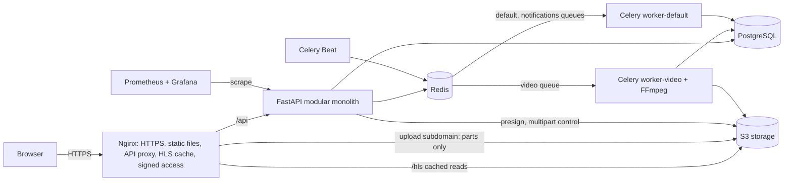
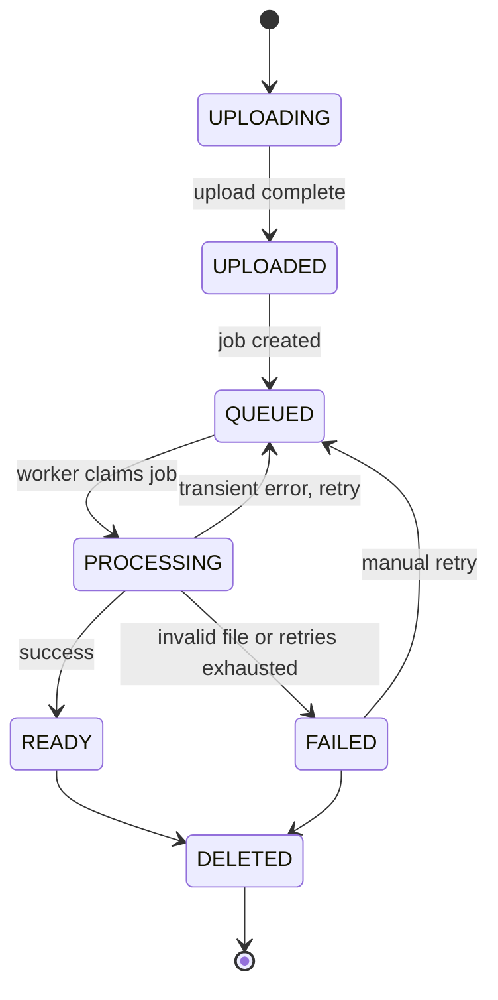

<div align="center">

# inVideo

**A self-hosted video platform with resumable uploads, background transcoding and adaptive HLS streaming**

**English** | [Русский](README.ru.md)

</div>

---

> **Project status: in development.** The architecture and technical design are complete; implementation follows the [roadmap](#roadmap). Features below describe the target scope of the project.

## Table of contents

- [inVideo](#invideo)
  - [Table of contents](#table-of-contents)
  - [About](#about)
  - [Features](#features)
    - [For viewers](#for-viewers)
    - [For creators](#for-creators)
    - [Under the hood](#under-the-hood)
  - [Architecture](#architecture)
  - [How it works](#how-it-works)
    - [1. Resumable upload](#1-resumable-upload)
    - [2. Processing pipeline](#2-processing-pipeline)
    - [3. Adaptive streaming](#3-adaptive-streaming)
    - [4. View counting](#4-view-counting)
    - [5. Search and recommendations](#5-search-and-recommendations)
  - [Tech stack](#tech-stack)
  - [Key engineering decisions](#key-engineering-decisions)
  - [Security](#security)
  - [Project structure](#project-structure)
  - [Getting started](#getting-started)
  - [Testing](#testing)
  - [Deployment](#deployment)
  - [Roadmap](#roadmap)
  - [Documentation](#documentation)
  - [Author](#author)
  - [License](#license)

## About

**inVideo** is a video hosting platform — a focused, simplified alternative to YouTube. Users sign up, create channels, upload videos, watch them in adaptive quality, search, react, comment, subscribe and build playlists. Creators manage their content and track statistics in Creator Studio.

The project does not try to copy every YouTube feature. Its goal is to implement the core features well and to solve the genuinely hard engineering problems behind a video platform:

- uploading multi-gigabyte files reliably, with resume after network failures;
- transcoding video in the background without slowing down the API;
- streaming adaptive video to any device while keeping private videos private;
- keeping counters, views and state consistent under concurrency and failures.

It is built as a portfolio project to demonstrate Python backend development, system design, databases, asynchronous processing, video pipelines, infrastructure and DevOps.

## Features

### For viewers

- Registration and login with secure session management across devices
- Adaptive HLS playback (360p–1080p) with manual quality selection and fast seeking
- Full-text search with Russian and English morphology, typo tolerance, filters and sorting
- Likes and dislikes, comments with replies
- Channel subscriptions and a subscriptions feed
- Playlists, "Watch later" and "Liked videos"
- Watch history with "Continue watching" from the last position
- Home feed with recommendations based on history, subscriptions, popularity and freshness
- In-app notifications, with optional Telegram delivery

### For creators

- Channel with handle, avatar, banner and description
- Upload of large files (up to several GB) directly to storage, with pause and resume
- Live processing progress and clear error messages for unsupported files
- Creator Studio: video management, visibility (public, unlisted, private), thumbnails, comments moderation, view statistics

### Under the hood

- Resumable S3 multipart uploads via presigned URLs — the API never proxies video bytes
- Idempotent, retry-safe FFmpeg processing pipeline in dedicated Celery workers
- HLS segments served by Nginx with disk cache and signed-cookie access control
- Anti-fraud view counting with deduplication and batched database writes
- Monitoring with Prometheus and Grafana, alerts to Telegram, automated deployments

## Architecture

inVideo is a **modular monolith** with **separate background workers**. All business logic lives in one FastAPI application split into well-bounded modules, while CPU-heavy video processing runs in isolated Celery workers that scale independently.



| Component | Responsibility |
| --- | --- |
| **Nginx** | Single entry point: TLS, SPA static files, API proxy, cached HLS delivery, signed-cookie checks, rate limiting |
| **FastAPI** | REST API and all business logic, organized into modules (auth, channels, uploads, videos, comments, search, …) |
| **Celery workers** | `worker-video` transcodes video; `worker-default` handles notifications, counters, cleanup |
| **PostgreSQL** | Source of truth for all data, full-text search |
| **Redis** | Celery broker, cache, rate limits, view deduplication, processing progress |
| **S3 storage** | Original files, HLS renditions, thumbnails, avatars |
| **Prometheus / Grafana** | Metrics, dashboards and alerts |

Python never serves video bytes: uploads go straight from the browser to storage, and playback segments are delivered by Nginx.

## How it works

### 1. Resumable upload

1. The browser asks the API to start an upload. The API checks permissions, size limits and quotas, creates the video record and an S3 multipart upload.
2. The browser requests presigned URLs for batches of 16 MiB parts and uploads them **directly to storage**, 3–4 in parallel. Each part is integrity-checked by its MD5.
3. If the connection drops or the tab is closed, the client asks the API which parts already exist and uploads only the missing ones.
4. On completion the API verifies all parts and the final size, then queues the video for processing.

### 2. Processing pipeline

A dedicated worker claims the job with a conditional update, so a job delivered twice is processed only once. Then it:

1. downloads the original and inspects it with **FFprobe** (real format, duration, resolution, rotation);
2. rejects unsupported or broken files with a clear error code;
3. extracts thumbnail candidates;
4. transcodes an **H.264/AAC bitrate ladder** (360p, 480p, 720p, 1080p — never upscaled) with aligned keyframes into 6-second HLS segments;
5. uploads renditions and writes the master playlist last;
6. marks the video `READY` only if it is still being processed (so a video deleted mid-processing stays deleted).

Transient failures are retried with exponential backoff; stuck jobs are recovered by a periodic sweeper.



### 3. Adaptive streaming

- The player (hls.js, native HLS in Safari) loads the master playlist, measures bandwidth on every segment and switches quality at segment boundaries.
- Nginx serves playlists and segments from S3 storage through a disk cache; versioned paths make everything cacheable as immutable.
- Access is controlled by a short-lived **signed cookie** scoped to the video path and verified by Nginx itself — no backend call per segment. Private videos are visible only to their owner.

### 4. View counting

A view counts only after real playback time (30 s, or half of a short video) and only with a signed view token issued when the page was opened. Views are deduplicated per viewer per 24 hours in Redis and flushed to PostgreSQL in batches once a minute — refreshing the page never inflates the counter.

### 5. Search and recommendations

- **Search** uses PostgreSQL full-text search with weighted fields (title > tags > description), Russian/English stemming and a trigram fallback for typos. Elasticsearch is intentionally not used at this scale.
- **Recommendations** follow a classic pipeline: candidate generation (subscriptions, interests, trends, fresh videos) → filtering → weighted scoring (affinity, popularity, freshness, quality) → diversification → Redis cache.

## Tech stack

| Area | Technologies |
| --- | --- |
| Backend | Python 3.12+, FastAPI, SQLAlchemy 2.0, Pydantic v2, Alembic, PyJWT, Argon2 |
| Frontend | React, TypeScript, Vite, Tailwind CSS, TanStack Query, Zustand, hls.js |
| Database | PostgreSQL 16 (full-text search, pg_trgm) |
| Cache and queues | Redis 7, Celery 5, Celery Beat |
| Video processing | FFmpeg, FFprobe |
| Streaming | HLS (H.264 + AAC), adaptive bitrate |
| Object storage | S3-compatible storage (MinIO or Garage) via boto3 |
| Infrastructure | Docker, Docker Compose, Nginx, Let's Encrypt, Linux VPS |
| Monitoring | Prometheus, Grafana, exporters, structlog |
| Testing | Pytest, HTTPX, testcontainers, Vitest, Playwright |
| CI/CD | GitHub Actions, GitHub Container Registry |
| Tooling | uv, Ruff, mypy, pre-commit, ESLint, Prettier |

## Key engineering decisions

| Decision | Why |
| --- | --- |
| Modular monolith instead of microservices | One developer, one deployment, real database transactions; heavy processing is already isolated behind a queue and can be extracted later |
| Direct-to-storage multipart upload | The API does not hold gigabytes in memory or connections; uploads resume after failures |
| Background transcoding in Celery | Transcoding takes minutes and must never run inside an HTTP request |
| HLS instead of DASH | Works natively on iOS/Safari and everywhere else through hls.js |
| Nginx serves video, not Python | Static delivery with caching is what Nginx is built for |
| Short-lived JWT + rotating refresh token in httpOnly cookie | Sessions can be revoked; stolen refresh tokens are detected on reuse |
| PostgreSQL full-text search | Sufficient for this scale without operating a separate search cluster |
| Storage accessed only via the S3 API | The storage engine can be swapped by changing configuration |

Each decision is documented as an Architecture Decision Record in [`docs/adr`](docs/adr).

## Security

- Untrusted files are never served as-is: every video is re-encoded, originals stay in a private bucket.
- Real file formats are detected by content (FFprobe, Pillow), not by extension.
- FFmpeg runs in an isolated, unprivileged container on an internal network, reads local files only and has CPU, memory and time limits.
- Passwords are hashed with Argon2id; brute force is limited at Nginx and application level.
- Refresh tokens are stored hashed, rotated on every use and revoke the session on reuse.
- Private videos return 404 to strangers and are excluded from search, feeds, recommendations and shared caches.
- Strict CSP, security headers, TLS 1.2+, no secrets in the repository or logs.

## Project structure

```text
invideo/
├── backend/          # FastAPI application, Celery tasks, migrations, tests
│   ├── app/
│   │   ├── core/     # config, database, security, storage, logging, errors
│   │   ├── modules/  # auth, users, channels, uploads, videos, processing, ...
│   │   └── workers/  # Celery app and Beat schedule
│   ├── alembic/
│   └── tests/
├── frontend/         # React + TypeScript SPA
├── e2e/              # Playwright end-to-end tests
├── infrastructure/   # Docker Compose, Nginx, monitoring, backup scripts
└── docs/             # architecture, ADRs, runbook
```

## Getting started

**Requirements:** Docker with Docker Compose, Make, Git.

1. Clone the repository.
2. Copy `.env.example` to `.env` and adjust values if needed.
3. Run `make up` — PostgreSQL, Redis, storage, API, workers, frontend and Nginx start together.
4. Run `make migrate` to apply database migrations, and optionally `make seed` to load demo data.
5. Open `http://localhost` for the app and `http://localhost/api/docs` for the interactive API documentation.

Other useful commands: `make test`, `make lint`, `make logs`, `make down`.

## Testing

| Level | What is tested | Tools |
| --- | --- | --- |
| Unit | Status transitions, bitrate ladder, recommendation scoring, tokens | Pytest |
| Integration | Repositories and services against real PostgreSQL, Redis and storage | Pytest, testcontainers |
| API | Endpoints, permissions, validation, idempotency | Pytest, HTTPX |
| Upload | Full multipart cycle, resume, integrity failures | Pytest, HTTPX |
| Processing | Real FFmpeg on generated test videos, retries, duplicate delivery | Pytest, FFmpeg |
| Frontend | Components and client logic | Vitest, React Testing Library, MSW |
| End-to-end | Sign up → upload → wait for processing → watch → comment → search | Playwright |

Test videos are generated by FFmpeg during the test run, so no binary fixtures are stored in the repository.

## Deployment

- A single Linux VPS running the production Docker Compose stack behind Nginx with HTTPS (Let's Encrypt).
- GitHub Actions runs linters, type checks and tests, builds images and pushes them to GitHub Container Registry.
- Deployments run migrations as a separate step, update services, check health and roll back automatically on failure.
- Prometheus and Grafana dashboards cover the API, queues, processing pipeline, database and disk; alerts are delivered to Telegram.
- Nightly encrypted PostgreSQL backups and copies of original videos are stored off-server. HLS renditions are not backed up — they can be regenerated from originals.

## Roadmap

- [ ] Project setup and backend foundation
- [ ] Authentication and sessions
- [ ] Users, channels and subscriptions
- [ ] Resumable video upload
- [ ] Video processing pipeline
- [ ] HLS streaming and first deployment
- [ ] Reactions, views and comments
- [ ] Search
- [ ] **MVP release**
- [ ] History, playlists and subscriptions feed
- [ ] Recommendations
- [ ] Full Creator Studio and statistics
- [ ] Notifications and Telegram integration
- [ ] Monitoring, alerts and automated deployment

Future ideas: seek-bar preview thumbnails, fMP4/CMAF segments, collaborative filtering and pgvector-based recommendations, CDN in front of Nginx.

## Documentation

- [`docs/architecture.md`](docs/architecture.md) — full technical design: business logic, diagrams, database schema, API, implementation plan
- [`docs/adr`](docs/adr) — architecture decision records
- [`docs/runbook.md`](docs/runbook.md) — deployment, rollback, backup restore, troubleshooting
- `/api/docs` — interactive OpenAPI documentation

## Author

**Timofey Kudakov** — Python backend / DevOps developer.

- GitHub: [@eachboy](https://github.com/eachboy)
- Telegram: [@eachboy](https://t.me/eachboy)
- Email: eachboy@yandex.ru

## License

Distributed under the MIT License. See [`LICENSE`](LICENSE) for details.