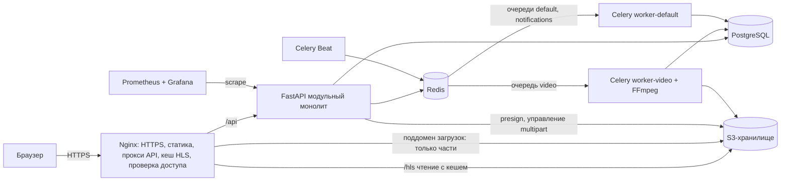
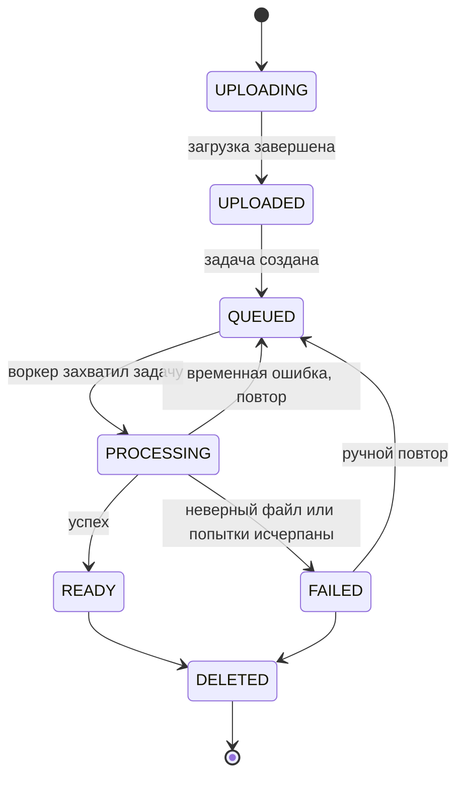

<div align="center">

# inVideo

**Собственная видеоплатформа с докачкой загрузок, фоновым транскодированием и адаптивным HLS-стримингом**

[English](README.md) | **Русский**

</div>

---

> **Статус проекта: в разработке.** Архитектура и техническое проектирование завершены; реализация идёт по [плану](#план-развития). Ниже описан целевой функционал проекта.

## Содержание

- [inVideo](#invideo)
  - [Содержание](#содержание)
  - [О проекте](#о-проекте)
  - [Возможности](#возможности)
    - [Для зрителей](#для-зрителей)
    - [Для авторов](#для-авторов)
    - [Под капотом](#под-капотом)
  - [Архитектура](#архитектура)
  - [Как это работает](#как-это-работает)
    - [1. Загрузка с докачкой](#1-загрузка-с-докачкой)
    - [2. Пайплайн обработки](#2-пайплайн-обработки)
    - [3. Адаптивный стриминг](#3-адаптивный-стриминг)
    - [4. Учёт просмотров](#4-учёт-просмотров)
    - [5. Поиск и рекомендации](#5-поиск-и-рекомендации)
  - [Технологии](#технологии)
  - [Ключевые инженерные решения](#ключевые-инженерные-решения)
  - [Безопасность](#безопасность)
  - [Структура проекта](#структура-проекта)
  - [Запуск](#запуск)
  - [Тестирование](#тестирование)
  - [Деплой](#деплой)
  - [План развития](#план-развития)
  - [Документация](#документация)
  - [Автор](#автор)
  - [Лицензия](#лицензия)

## О проекте

**inVideo** — видеохостинг, упрощённый аналог YouTube. Пользователи регистрируются, создают каналы, загружают видео, смотрят их в адаптивном качестве, ищут, ставят реакции, комментируют, подписываются и собирают плейлисты. Авторы управляют контентом и смотрят статистику в Creator Studio.

Проект не пытается повторить все функции YouTube. Его цель — качественно реализовать основные возможности и решить действительно сложные инженерные задачи видеоплатформы:

- надёжно загружать файлы в несколько гигабайт с докачкой после обрыва сети;
- транскодировать видео в фоне, не замедляя API;
- отдавать адаптивное видео на любые устройства, сохраняя приватные видео приватными;
- поддерживать согласованность счётчиков, просмотров и состояний при конкурентных запросах и сбоях.

Это портфолио-проект, демонстрирующий навыки Python backend-разработки, проектирования систем, работы с базами данных, асинхронной обработки, видеопайплайнов, инфраструктуры и DevOps.

## Возможности

### Для зрителей

- Регистрация и вход с безопасным управлением сессиями на разных устройствах
- Адаптивное воспроизведение HLS (360p–1080p) с ручным выбором качества и быстрой перемоткой
- Полнотекстовый поиск с русской и английской морфологией, устойчивостью к опечаткам, фильтрами и сортировкой
- Лайки и дизлайки, комментарии с ответами
- Подписки на каналы и лента подписок
- Плейлисты, «Смотреть позже» и «Понравившиеся»
- История просмотров и «Продолжить просмотр» с последней позиции
- Главная лента с рекомендациями на основе истории, подписок, популярности и свежести
- Уведомления в интерфейсе с опциональной доставкой в Telegram

### Для авторов

- Канал с handle, аватаром, баннером и описанием
- Загрузка больших файлов (до нескольких ГБ) напрямую в хранилище, с паузой и продолжением
- Прогресс обработки в реальном времени и понятные сообщения об ошибках для неподдерживаемых файлов
- Creator Studio: управление видео, видимость (публичное, по ссылке, приватное), обложки, модерация комментариев, статистика просмотров

### Под капотом

- Докачиваемая S3 multipart-загрузка по presigned URL — API никогда не пропускает через себя байты видео
- Идемпотентный и устойчивый к повторам пайплайн обработки FFmpeg в отдельных Celery-воркерах
- Раздача HLS-сегментов через Nginx с дисковым кешем и проверкой доступа по подписанной cookie
- Учёт просмотров с защитой от накрутки, дедупликацией и пакетной записью в базу
- Мониторинг на Prometheus и Grafana, алерты в Telegram, автоматический деплой

## Архитектура

inVideo — **модульный монолит** с **отдельными фоновыми воркерами**. Вся бизнес-логика живёт в одном FastAPI-приложении, разделённом на модули с чёткими границами, а тяжёлая обработка видео выполняется в изолированных Celery-воркерах, которые масштабируются независимо.



| Компонент | Ответственность |
| --- | --- |
| **Nginx** | Единая точка входа: TLS, статика SPA, прокси API, раздача HLS с кешем, проверка подписанных cookie, rate limiting |
| **FastAPI** | REST API и вся бизнес-логика, разделённая на модули (auth, channels, uploads, videos, comments, search, …) |
| **Celery-воркеры** | `worker-video` транскодирует видео; `worker-default` — уведомления, счётчики, очистка |
| **PostgreSQL** | Источник правды для всех данных, полнотекстовый поиск |
| **Redis** | Брокер Celery, кеш, rate limits, дедупликация просмотров, прогресс обработки |
| **S3-хранилище** | Оригиналы, HLS-рендишны, обложки, аватары |
| **Prometheus / Grafana** | Метрики, дашборды и алерты |

Python никогда не передаёт байты видео: загрузка идёт из браузера прямо в хранилище, а сегменты для воспроизведения отдаёт Nginx.

## Как это работает

### 1. Загрузка с докачкой

1. Браузер просит API начать загрузку. API проверяет права, лимиты размера и квоты, создаёт запись о видео и multipart-загрузку в S3.
2. Браузер запрашивает presigned URL для пачек частей по 16 МиБ и загружает их **напрямую в хранилище**, по 3–4 параллельно. Целостность каждой части проверяется по MD5.
3. Если соединение оборвалось или вкладка закрылась, клиент спрашивает у API, какие части уже загружены, и догружает только недостающие.
4. При завершении API проверяет все части и итоговый размер и ставит видео в очередь на обработку.

### 2. Пайплайн обработки

Отдельный воркер захватывает задачу условным обновлением, поэтому задача, доставленная дважды, обрабатывается один раз. Затем он:

1. скачивает оригинал и анализирует его через **FFprobe** (реальный формат, длительность, разрешение, поворот);
2. отклоняет неподдерживаемые и повреждённые файлы с понятным кодом ошибки;
3. извлекает кадры-кандидаты для обложки;
4. транскодирует **лесенку качеств H.264/AAC** (360p, 480p, 720p, 1080p — без апскейла) с выровненными ключевыми кадрами в HLS-сегменты по 6 секунд;
5. загружает рендишны и последним записывает master playlist;
6. переводит видео в `READY`, только если оно всё ещё обрабатывается (видео, удалённое во время обработки, остаётся удалённым).

Временные ошибки повторяются с экспоненциальной задержкой; зависшие задачи восстанавливает периодический «подметальщик».



### 3. Адаптивный стриминг

- Плеер (hls.js, в Safari — нативный HLS) загружает master playlist, измеряет скорость на каждом сегменте и переключает качество на границах сегментов.
- Nginx отдаёт плейлисты и сегменты из S3-хранилища через дисковый кеш; версионные пути позволяют кешировать всё как неизменяемое.
- Доступ контролирует короткоживущая **подписанная cookie**, ограниченная путём видео и проверяемая самим Nginx — без обращения к backend на каждый сегмент. Приватные видео видит только владелец.

### 4. Учёт просмотров

Просмотр засчитывается только после реального воспроизведения (30 секунд или половина короткого видео) и только с подписанным токеном просмотра, выданным при открытии страницы. Просмотры дедуплицируются в Redis для каждого зрителя на 24 часа и пакетно сбрасываются в PostgreSQL раз в минуту — обновление страницы не увеличивает счётчик.

### 5. Поиск и рекомендации

- **Поиск** работает на полнотекстовом поиске PostgreSQL со взвешенными полями (название > теги > описание), русской и английской морфологией и триграммным поиском для опечаток. Elasticsearch на таком масштабе сознательно не используется.
- **Рекомендации** устроены по классической схеме: сбор кандидатов (подписки, интересы, тренды, свежие видео) → фильтрация → взвешенная оценка (близость к интересам, популярность, свежесть, качество) → разнообразие → кеш в Redis.

## Технологии

| Область | Технологии |
| --- | --- |
| Backend | Python 3.12+, FastAPI, SQLAlchemy 2.0, Pydantic v2, Alembic, PyJWT, Argon2 |
| Frontend | React, TypeScript, Vite, Tailwind CSS, TanStack Query, Zustand, hls.js |
| База данных | PostgreSQL 16 (полнотекстовый поиск, pg_trgm) |
| Кеш и очереди | Redis 7, Celery 5, Celery Beat |
| Обработка видео | FFmpeg, FFprobe |
| Стриминг | HLS (H.264 + AAC), адаптивный битрейт |
| Объектное хранилище | S3-совместимое хранилище (MinIO или Garage) через boto3 |
| Инфраструктура | Docker, Docker Compose, Nginx, Let's Encrypt, Linux VPS |
| Мониторинг | Prometheus, Grafana, экспортеры, structlog |
| Тестирование | Pytest, HTTPX, testcontainers, Vitest, Playwright |
| CI/CD | GitHub Actions, GitHub Container Registry |
| Инструменты | uv, Ruff, mypy, pre-commit, ESLint, Prettier |

## Ключевые инженерные решения

| Решение | Почему |
| --- | --- |
| Модульный монолит вместо микросервисов | Один разработчик, один деплой, настоящие транзакции БД; тяжёлая обработка уже изолирована очередью и может быть вынесена позже |
| Загрузка напрямую в хранилище частями | API не держит гигабайты в памяти и соединениях; загрузка продолжается после сбоев |
| Фоновое транскодирование в Celery | Транскодирование занимает минуты и не должно выполняться внутри HTTP-запроса |
| HLS вместо DASH | Нативно работает в iOS и Safari, в остальных браузерах — через hls.js |
| Видео отдаёт Nginx, а не Python | Раздача статики с кешем — именно то, для чего создан Nginx |
| Короткий JWT + ротируемый refresh-токен в httpOnly-cookie | Сессии можно отозвать; украденный refresh-токен обнаруживается при повторном использовании |
| Полнотекстовый поиск PostgreSQL | Достаточен для такого масштаба без отдельного поискового кластера |
| Хранилище только через S3 API | Движок хранилища меняется сменой конфигурации |

Каждое решение оформлено как Architecture Decision Record в [`docs/adr`](docs/adr).

## Безопасность

- Недоверенные файлы никогда не отдаются как есть: каждое видео перекодируется, оригиналы лежат в приватном бакете.
- Реальный формат файлов определяется по содержимому (FFprobe, Pillow), а не по расширению.
- FFmpeg работает в изолированном непривилегированном контейнере во внутренней сети, читает только локальные файлы и ограничен по CPU, памяти и времени.
- Пароли хешируются Argon2id; перебор ограничен на уровне Nginx и приложения.
- Refresh-токены хранятся хешированными, ротируются при каждом использовании и при повторном использовании отзывают сессию.
- Приватные видео возвращают посторонним 404 и исключены из поиска, лент, рекомендаций и общих кешей.
- Строгий CSP, заголовки безопасности, TLS 1.2+, никаких секретов в репозитории и логах.

## Структура проекта

```text
invideo/
├── backend/          # FastAPI-приложение, задачи Celery, миграции, тесты
│   ├── app/
│   │   ├── core/     # конфигурация, БД, безопасность, хранилище, логи, ошибки
│   │   ├── modules/  # auth, users, channels, uploads, videos, processing, ...
│   │   └── workers/  # Celery-приложение и расписание Beat
│   ├── alembic/
│   └── tests/
├── frontend/         # SPA на React + TypeScript
├── e2e/              # end-to-end тесты Playwright
├── infrastructure/   # Docker Compose, Nginx, мониторинг, скрипты бэкапа
└── docs/             # архитектура, ADR, runbook
```

## Запуск

**Требования:** Docker с Docker Compose, Make, Git.

1. Клонируйте репозиторий.
2. Скопируйте `.env.example` в `.env` и при необходимости измените значения.
3. Выполните `make up` — вместе поднимутся PostgreSQL, Redis, хранилище, API, воркеры, фронтенд и Nginx.
4. Выполните `make migrate`, чтобы применить миграции, и при желании `make seed`, чтобы загрузить демо-данные.
5. Откройте `http://localhost` — приложение, `http://localhost/api/docs` — интерактивная документация API.

Другие полезные команды: `make test`, `make lint`, `make logs`, `make down`.

## Тестирование

| Уровень | Что проверяется | Инструменты |
| --- | --- | --- |
| Unit | Переходы статусов, лесенка качеств, оценка рекомендаций, токены | Pytest |
| Integration | Репозитории и сервисы на настоящих PostgreSQL, Redis и хранилище | Pytest, testcontainers |
| API | Endpoint-ы, права доступа, валидация, идемпотентность | Pytest, HTTPX |
| Загрузка | Полный multipart-цикл, докачка, ошибки целостности | Pytest, HTTPX |
| Обработка | Настоящий FFmpeg на сгенерированных роликах, повторы, двойная доставка | Pytest, FFmpeg |
| Frontend | Компоненты и клиентская логика | Vitest, React Testing Library, MSW |
| End-to-end | Регистрация → загрузка → ожидание обработки → просмотр → комментарий → поиск | Playwright |

Тестовые видео генерирует FFmpeg во время запуска тестов, поэтому бинарные файлы в репозитории не хранятся.

## Деплой

- Один Linux VPS с продакшен-стеком Docker Compose за Nginx с HTTPS (Let's Encrypt).
- GitHub Actions запускает линтеры, проверку типов и тесты, собирает образы и публикует их в GitHub Container Registry.
- Деплой применяет миграции отдельным шагом, обновляет сервисы, проверяет их здоровье и автоматически откатывается при ошибке.
- Дашборды Prometheus и Grafana покрывают API, очереди, пайплайн обработки, базу данных и диск; алерты приходят в Telegram.
- Еженощные зашифрованные бэкапы PostgreSQL и копии оригиналов видео хранятся за пределами сервера. HLS-рендишны не бэкапятся — их можно заново получить из оригиналов.

## План развития

- [ ] Подготовка проекта и каркас backend
- [ ] Авторизация и сессии
- [ ] Пользователи, каналы и подписки
- [ ] Загрузка видео с докачкой
- [ ] Пайплайн обработки видео
- [ ] HLS-стриминг и первый деплой
- [ ] Реакции, просмотры и комментарии
- [ ] Поиск
- [ ] **Релиз MVP**
- [ ] История, плейлисты и лента подписок
- [ ] Рекомендации
- [ ] Полный Creator Studio и статистика
- [ ] Уведомления и интеграция с Telegram
- [ ] Мониторинг, алерты и автоматический деплой

Идеи на будущее: превью кадров при наведении на полосу перемотки, сегменты fMP4/CMAF, коллаборативная фильтрация и рекомендации на pgvector, CDN перед Nginx.

## Документация

- [`docs/architecture.md`](docs/architecture.md) — полное техническое проектирование: бизнес-логика, диаграммы, схема базы данных, API, план реализации
- [`docs/adr`](docs/adr) — записи архитектурных решений
- [`docs/runbook.md`](docs/runbook.md) — деплой, откат, восстановление из бэкапа, решение проблем
- `/api/docs` — интерактивная документация OpenAPI

## Автор

**Тимофей Кудаков** — Python backend / DevOps-разработчик.

- GitHub: [@eachboy](https://github.com/eachboy)
- Telegram: [@eachboy](https://t.me/eachboy)
- Email: eachboy@yandex.ru

## Лицензия

Распространяется под лицензией MIT. Подробнее — в файле [`LICENSE`](LICENSE).