# Часть III. Архитектура системы

## 3.1. Общая архитектура

### Выбор: модульный монолит с отдельными воркерами

| Критерий | Модульный монолит | Микросервисы |
| --- | --- | --- |
| Число деплоев | Один образ API + тот же образ для воркеров | По одному на сервис |
| Транзакции между модулями | Обычная транзакция PostgreSQL | Распределённые транзакции, саги, eventual consistency |
| Отладка | Один стек-трейс, одни логи | Распределённая трассировка обязательна |
| Инфраструктура | Docker Compose на одном VPS | Service discovery, API gateway, отдельные БД, часто Kubernetes |
| Скорость разработки одним человеком | Высокая | Низкая: большая часть времени уходит на инфраструктуру |
| Независимое масштабирование | Только для воркеров (которым оно и нужно) | Для каждого сервиса |

**Решение:** модульный монолит. Код разделён на модули с чёткими границами (auth, users, channels, videos, uploads и т.д.), но работает в одном процессе FastAPI и с одной базой. Тяжёлая и медленная часть — обработка видео — вынесена в отдельные процессы Celery-воркеров: они масштабируются независимо, и транскодирование не тормозит API.

Если когда-нибудь понадобятся микросервисы, первым кандидатом станет обработка видео — она уже изолирована очередью. Хорошие границы модулей делают такой вынос механическим. Это сильный аргумент для собеседования: «я выбрал монолит осознанно и знаю, где он разрежется».

Воркеры используют **тот же код и тот же Docker-образ**, что и API, но запускаются другой командой. Модели, конфигурация и сервисы общие, дублирования нет.

### Компоненты и взаимодействие

| Компонент | Роль | С кем взаимодействует |
| --- | --- | --- |
| Frontend (React SPA) | Интерфейс; собранная статика | Браузер загружает её у Nginx; ходит в API, в хранилище (загрузка частей) и за HLS |
| Nginx | Единая точка входа: HTTPS, статика, проксирование API, раздача HLS с кешем и проверкой подписи, прокси загрузок в MinIO, rate limiting | Браузер, FastAPI, MinIO |
| FastAPI | Вся бизнес-логика и REST API | PostgreSQL, Redis, MinIO (управляющие операции), Celery (через Redis) |
| PostgreSQL | Источник правды для всех данных | FastAPI, воркеры |
| Redis | Брокер Celery, кеш, rate limits, счётчики, дедупликация, прогресс обработки | FastAPI, воркеры, Beat |
| Celery worker-video | Обработка видео: FFprobe, FFmpeg, HLS | Redis, PostgreSQL, MinIO, локальный диск |
| Celery worker-default | Лёгкие задачи: уведомления, Telegram, счётчики, очистка, изображения | Redis, PostgreSQL, MinIO, Telegram API |
| Celery Beat | Планировщик периодических задач | Redis |
| MinIO | Объекты: оригиналы, HLS, превью, аватары | Браузер (только загрузка через Nginx), FastAPI, воркеры, Nginx |
| Prometheus | Сбор метрик | Опрашивает API, экспортеры, MinIO |
| Grafana | Дашборды и алерты | Prometheus |

### Схема общей архитектуры

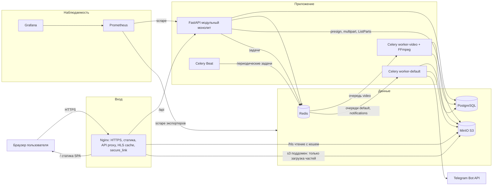

## 3.2. Диаграммы процессов

### 1. Регистрация, вход и обновление токенов

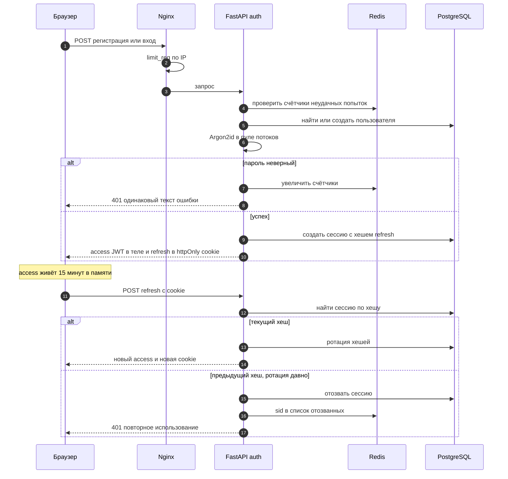

### 2. Загрузка видео

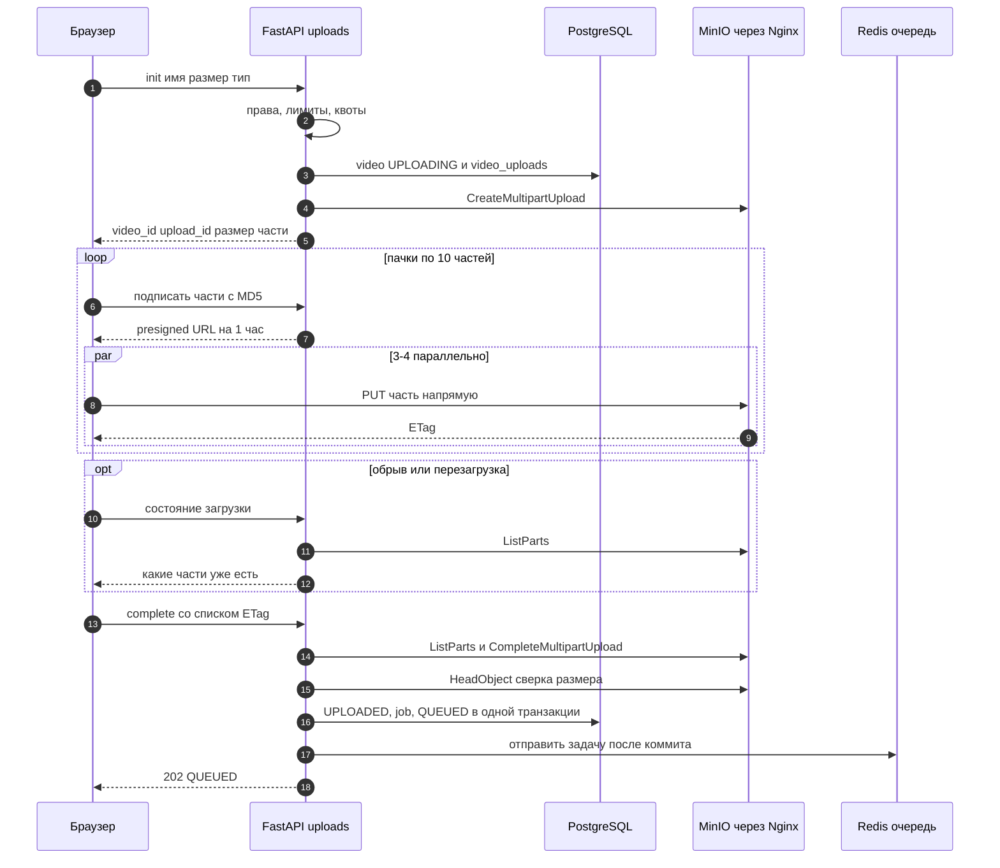

### 3. Обработка видео и статусы

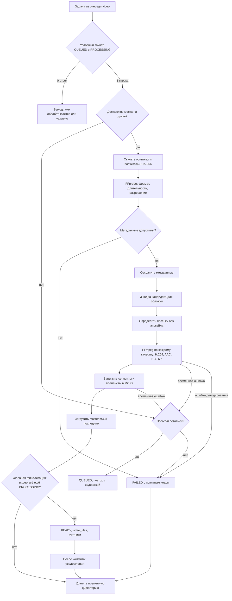

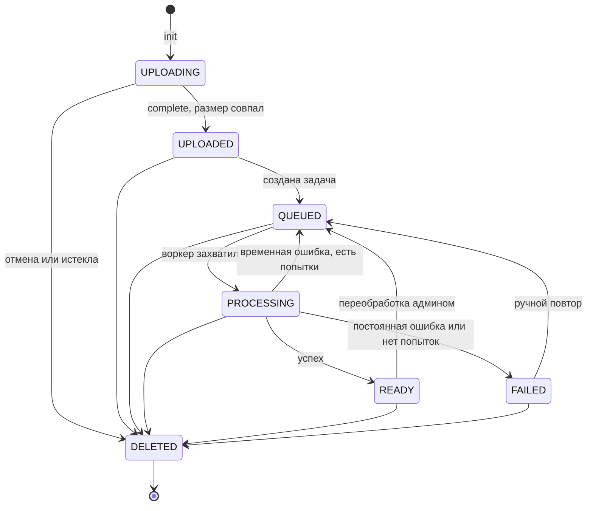

### 4. HLS Streaming

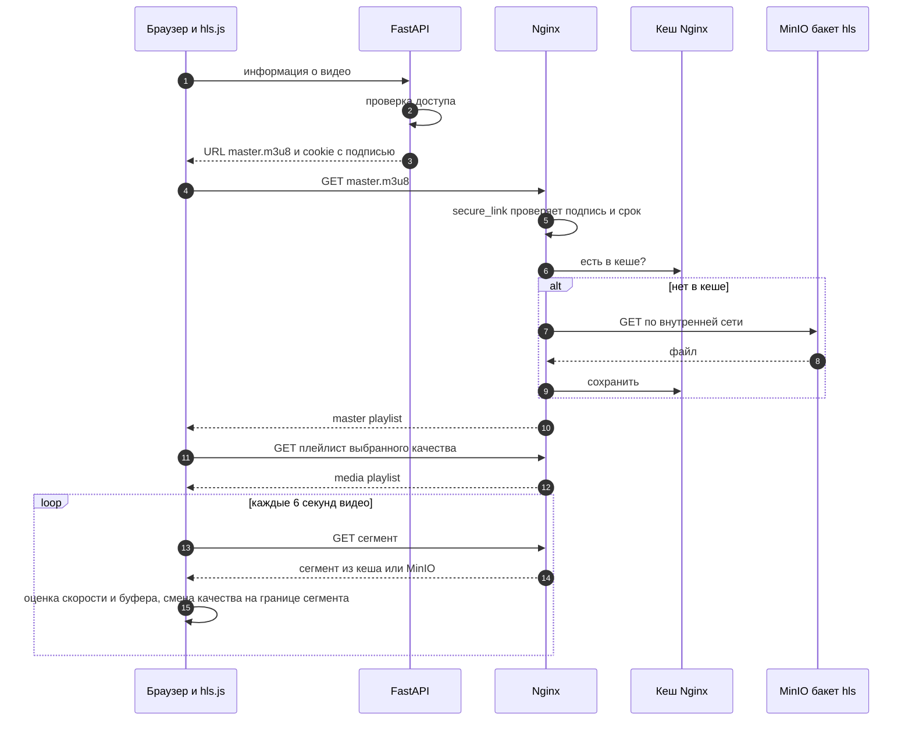

### 5. Просмотр видео и учёт просмотров

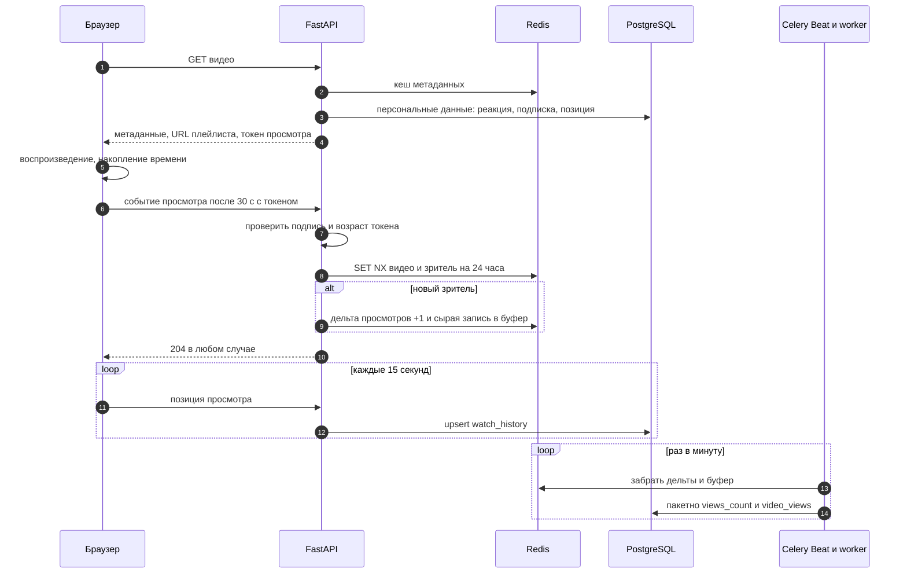

### 6. Работа очередей задач

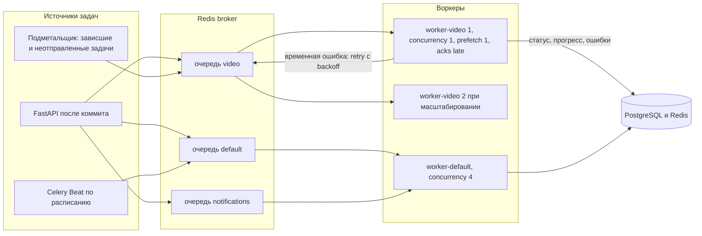

### 7. Система рекомендаций

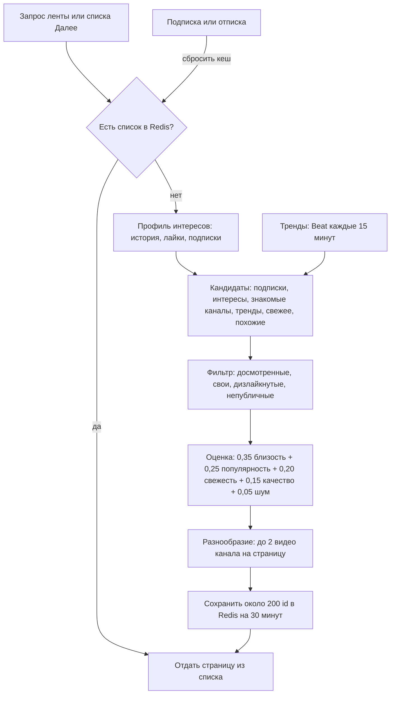

## 3.3. Database Design

### Общие соглашения

- **Первичные ключи** — BIGINT с автогенерацией (identity): компактные и быстрые индексы. Наружу, в URL, выходят не они, а публичные идентификаторы: у видео и плейлистов — случайная строка из 11 символов, у каналов — handle, у сессий — UUID.
- **Время** — всегда TIMESTAMPTZ (с часовым поясом), хранится в UTC. У большинства таблиц есть created\_at и updated\_at.
- **Перечисления** (статусы, видимость, роли) — VARCHAR с ограничением CHECK. Нативный тип ENUM в PostgreSQL неудобно менять миграциями; на стороне Python значения описаны enum-классами.
- **Счётчики** — BIGINT или INTEGER со значением по умолчанию 0 и ограничением «не меньше нуля».
- **Удаление.** Видео и комментарии удаляются мягко (статус), остальное — физически. Поведение внешних ключей при удалении родителя задаётся явно: CASCADE для зависимых данных (сессии, реакции пользователя), SET NULL там, где запись должна пережить автора (просмотры, уведомления).
- **Имена** — snake\_case, таблицы во множественном числе, индексы по шаблону «ix\_таблица\_поля», уникальные ограничения — «uq\_таблица\_поля». Шаблон имён задаётся в метаданных SQLAlchemy, чтобы Alembic генерировал стабильные имена.
- **Удаление аккаунта** — расширение: данные пользователя обезличиваются, его видео и канал удаляются, комментарии остаются как «Удалённый пользователь».

К списку из задания добавлена одна таблица — `video_uploads`. Состояние multipart-загрузки (upload\_id в хранилище, размер части, срок жизни) живёт недолго и не относится к самому видео; держать его в `videos` означало бы засорять главную таблицу временными полями.

### users — пользователи

| Поле | Тип | Описание |
| --- | --- | --- |
| id | BIGINT, PK | Идентификатор |
| email | VARCHAR(254) | В нижнем регистре, уникальный |
| username | VARCHAR(30) | В нижнем регистре, уникальный |
| display\_name | VARCHAR(50) | Отображаемое имя |
| password\_hash | VARCHAR(255) | Хеш Argon2id вместе с параметрами и солью |
| role | VARCHAR(16) | user или admin |
| status | VARCHAR(16) | active или banned |
| is\_email\_verified | BOOLEAN | По умолчанию false |
| avatar\_key | VARCHAR(255), NULL | Префикс аватара в хранилище с версией |
| bio | VARCHAR(500) | Короткое описание |
| history\_paused | BOOLEAN | Пауза истории |
| subscriptions\_public | BOOLEAN | Публичность подписок |
| notification\_settings | JSONB | Настройки уведомлений по типам и каналам доставки |
| telegram\_chat\_id | BIGINT, NULL | Привязанный чат Telegram, уникальный |
| username\_changed\_at, last\_login\_at | TIMESTAMPTZ, NULL | Служебные даты |
| created\_at, updated\_at | TIMESTAMPTZ |  |

Индексы и ограничения: уникальные email, username и telegram\_chat\_id (последний — частичный, только для непустых значений). CHECK для role и status.

### user\_sessions — сессии

| Поле | Тип | Описание |
| --- | --- | --- |
| id | UUID, PK | sid, попадает в access-токен |
| user\_id | BIGINT, FK → users, CASCADE | Владелец |
| refresh\_token\_hash | CHAR(64) | SHA-256 текущего refresh-токена |
| previous\_token\_hash | CHAR(64), NULL | Хеш предыдущего токена (для обнаружения повторного использования) |
| rotated\_at | TIMESTAMPTZ, NULL | Время последней ротации |
| user\_agent | VARCHAR(512) | Устройство |
| ip | INET | IP при последнем использовании |
| created\_at, last\_used\_at, expires\_at | TIMESTAMPTZ |  |
| revoked\_at | TIMESTAMPTZ, NULL | Время отзыва |
| revoke\_reason | VARCHAR(32), NULL | logout, logout\_all, password\_change, reuse\_detected |

Индексы: уникальный по refresh\_token\_hash; обычный по previous\_token\_hash; по user\_id — частичный, только активные (revoked\_at пуст).

### channels — каналы

| Поле | Тип | Описание |
| --- | --- | --- |
| id | BIGINT, PK |  |
| owner\_id | BIGINT, FK → users, CASCADE | Уникальный: один канал на пользователя |
| handle | VARCHAR(30) | В нижнем регистре, уникальный |
| title | VARCHAR(100) | Название |
| description | TEXT | CHECK длины до 5000 |
| banner\_key | VARCHAR(255), NULL | Баннер |
| subscribers\_count | BIGINT | Счётчик |
| videos\_count | INTEGER | Публичные готовые видео |
| total\_views | BIGINT | Сумма просмотров |
| hide\_subscriber\_count | BOOLEAN | Приватность |
| handle\_changed\_at | TIMESTAMPTZ, NULL |  |
| created\_at, updated\_at | TIMESTAMPTZ |  |

Индексы: уникальные owner\_id и handle; GIN с триграммами по title и handle — для поиска каналов.

### videos — видео

| Поле | Тип | Описание |
| --- | --- | --- |
| id | BIGINT, PK |  |
| public\_id | CHAR(11) | Публичный идентификатор, уникальный |
| channel\_id | BIGINT, FK → channels, CASCADE | Канал |
| title | VARCHAR(100) | Название |
| description | TEXT | До 5000 символов |
| tags | TEXT\[\] | До 15 тегов |
| category | VARCHAR(32) | Из фиксированного списка, CHECK |
| status | VARCHAR(16) | UPLOADING … DELETED |
| visibility | VARCHAR(16) | public, unlisted, private |
| moderation\_status | VARCHAR(16) | ok или hidden |
| comments\_enabled | BOOLEAN |  |
| duration\_seconds | NUMERIC(10,3), NULL | Заполняется после FFprobe |
| width, height | INTEGER, NULL | Исходное разрешение |
| processing\_version | INTEGER | Номер версии результатов обработки |
| master\_playlist\_key | VARCHAR(512), NULL | Путь к master.m3u8 |
| thumbnail\_key | VARCHAR(512), NULL | Текущая обложка |
| views\_count, likes\_count, dislikes\_count, comments\_count | BIGINT | Денормализованные счётчики |
| search\_vector | TSVECTOR | Поисковый вектор |
| created\_at, updated\_at | TIMESTAMPTZ |  |
| published\_at, processed\_at, deleted\_at | TIMESTAMPTZ, NULL |  |

Поисковый вектор поддерживается триггером. Вычисляемая колонка (generated column) подойдёт, если в вектор входят только название и описание; с массивом тегов функция преобразования не считается неизменяемой, и PostgreSQL её не примет.

Индексы:

- уникальный по public\_id;
- по паре «канал + дата публикации по убыванию», частичный (только READY и не удалённые) — страница канала и лента подписок;
- по дате публикации по убыванию, частичный (только публичные READY) — свежие видео и тренды;
- по паре «категория + дата публикации», частичный — кандидаты для рекомендаций;
- GIN по search\_vector, частичный (публичные READY, не скрытые) — поиск;
- GIN с триграммами по title — опечатки и подсказки;
- по status, частичный (только UPLOADING, QUEUED, PROCESSING) — для фоновых «подметальщиков».

### video\_uploads — состояние загрузки

| Поле | Тип | Описание |
| --- | --- | --- |
| id | BIGINT, PK |  |
| video\_id | BIGINT, FK → videos, CASCADE | Уникальный |
| user\_id | BIGINT, FK → users | Кто загружает |
| s3\_upload\_id | VARCHAR(255) | Идентификатор multipart-загрузки в хранилище |
| object\_key | VARCHAR(512) | Ключ оригинала |
| declared\_size | BIGINT | Заявленный размер в байтах |
| declared\_content\_type | VARCHAR(100) | Заявленный тип |
| part\_size | INTEGER | Размер части |
| parts\_count | INTEGER | Число частей |
| status | VARCHAR(16) | active, completed, aborted, expired |
| created\_at, expires\_at, completed\_at | TIMESTAMPTZ |  |

Индексы: уникальный по video\_id; по «статус + срок», частичный для active — поиск брошенных загрузок.

### video\_files — файлы видео

| Поле | Тип | Описание |
| --- | --- | --- |
| id | BIGINT, PK |  |
| video\_id | BIGINT, FK → videos, CASCADE |  |
| kind | VARCHAR(24) | source, hls\_master, hls\_rendition, thumbnail, thumbnail\_candidate |
| rendition | VARCHAR(8), NULL | 360p, 480p, 720p, 1080p |
| processing\_version | INTEGER | Версия обработки |
| object\_key | VARCHAR(512) | Для рендишна — путь к его плейлисту |
| width, height, bitrate | INTEGER, NULL |  |
| size\_bytes | BIGINT, NULL |  |
| codec | VARCHAR(32), NULL |  |
| sha256 | CHAR(64), NULL | Для оригинала |
| created\_at | TIMESTAMPTZ |  |

Отдельные HLS-сегменты в базе не хранятся — их тысячи, и они полностью описываются плейлистом. Индексы: уникальный по object\_key; по паре «видео + версия».

### video\_processing\_jobs — задачи обработки

| Поле | Тип | Описание |
| --- | --- | --- |
| id | BIGINT, PK |  |
| video\_id | BIGINT, FK → videos, CASCADE |  |
| status | VARCHAR(16) | QUEUED, PROCESSING, SUCCEEDED, FAILED, CANCELLED |
| attempt, max\_attempts | SMALLINT | Номер попытки и лимит |
| processing\_version | INTEGER | Версия, которую создаёт задача |
| stage | VARCHAR(32), NULL | Текущий этап |
| celery\_task\_id | VARCHAR(64), NULL | Для отладки |
| worker\_name | VARCHAR(128), NULL | Кто обрабатывает |
| enqueued\_at, started\_at, heartbeat\_at, finished\_at | TIMESTAMPTZ, NULL |  |
| error\_code | VARCHAR(48), NULL | Машиночитаемый код |
| error\_message | TEXT, NULL | Сообщение для автора |
| error\_details | TEXT, NULL | Хвост stderr FFmpeg, до нескольких КБ |
| created\_at | TIMESTAMPTZ |  |

Индексы: частичный уникальный по video\_id для статусов QUEUED и PROCESSING — не больше одной активной задачи на видео; по «статус + heartbeat\_at» — поиск зависших задач.

### video\_views — сырые события просмотров

| Поле | Тип | Описание |
| --- | --- | --- |
| id | BIGINT, PK |  |
| video\_id | BIGINT, FK → videos, CASCADE |  |
| user\_id | BIGINT, NULL, FK → users, SET NULL | Пусто для гостя |
| viewer\_hash | CHAR(64) | Хеш ключа зрителя |
| ip\_hash | CHAR(64) | Хеш IP с солью — сырой IP не храним |
| watched\_seconds | INTEGER | Время просмотра на момент засчитывания |
| created\_at | TIMESTAMPTZ |  |

Индексы: по паре «видео + время» — статистика по дням; по паре «пользователь + время», частичный. Таблица только растёт: при большом объёме — партиционирование по месяцам и хранение сырых данных 13 месяцев.

### subscriptions — подписки

| Поле | Тип | Описание |
| --- | --- | --- |
| user\_id | BIGINT, FK → users, CASCADE | Подписчик |
| channel\_id | BIGINT, FK → channels, CASCADE | Канал |
| notify | BOOLEAN | «Колокольчик», по умолчанию true |
| created\_at | TIMESTAMPTZ |  |

PK — составной (user\_id, channel\_id): он же гарантирует уникальность и обслуживает «на кого подписан пользователь». Дополнительный индекс по «канал + дата подписки» — список подписчиков. Запрет подписки на свой канал проверяется в сервисе: CHECK не может смотреть в другую таблицу.

### video\_reactions — лайки и дизлайки

| Поле | Тип | Описание |
| --- | --- | --- |
| user\_id | BIGINT, FK → users, CASCADE |  |
| video\_id | BIGINT, FK → videos, CASCADE |  |
| value | SMALLINT | CHECK: 1 или −1 |
| created\_at, updated\_at | TIMESTAMPTZ |  |

PK — (user\_id, video\_id). Индексы: по «видео + значение» — для сверки счётчиков; по «пользователь + updated\_at», частичный для лайков — список «Понравившиеся».

### comments — комментарии

| Поле | Тип | Описание |
| --- | --- | --- |
| id | BIGINT, PK |  |
| video\_id | BIGINT, FK → videos, CASCADE |  |
| author\_id | BIGINT, FK → users, CASCADE |  |
| parent\_id | BIGINT, NULL, FK → comments, CASCADE | Пусто для верхнего уровня |
| reply\_to\_user\_id | BIGINT, NULL, FK → users, SET NULL | Кому ответ |
| text | TEXT | CHECK длины 1–5000 |
| status | VARCHAR(16) | visible, deleted, hidden |
| is\_pinned | BOOLEAN |  |
| replies\_count | INTEGER |  |
| edited\_at | TIMESTAMPTZ, NULL |  |
| created\_at, updated\_at | TIMESTAMPTZ |  |

Индексы: по «видео + дата создания + id», частичный для верхнего уровня — лента комментариев; по «родитель + дата» — ответы; по автору; частичный уникальный по video\_id для закреплённых — не больше одного закреплённого на видео.

### playlists — плейлисты

| Поле | Тип | Описание |
| --- | --- | --- |
| id | BIGINT, PK |  |
| public\_id | CHAR(11) | Уникальный |
| owner\_id | BIGINT, FK → users, CASCADE |  |
| title | VARCHAR(150) |  |
| description | TEXT |  |
| visibility | VARCHAR(16) | public, unlisted, private |
| kind | VARCHAR(16) | regular или watch\_later |
| videos\_count | INTEGER |  |
| created\_at, updated\_at | TIMESTAMPTZ |  |

Индексы: уникальный по public\_id; по «владелец + updated\_at»; частичный уникальный по owner\_id для watch\_later — у каждого один список «Смотреть позже».

### playlist\_videos — видео в плейлистах

| Поле | Тип | Описание |
| --- | --- | --- |
| playlist\_id | BIGINT, FK → playlists, CASCADE |  |
| video\_id | BIGINT, FK → videos, CASCADE |  |
| position | INTEGER | Порядок, начиная с 1 |
| added\_at | TIMESTAMPTZ |  |

PK — (playlist\_id, video\_id): видео не дублируется. Уникальность «плейлист + позиция» с отложенной проверкой (DEFERRABLE INITIALLY DEFERRED): во время сдвига позиций в транзакции временные дубли допустимы, а к коммиту порядок должен быть корректным.

### watch\_history — история просмотров

| Поле | Тип | Описание |
| --- | --- | --- |
| user\_id | BIGINT, FK → users, CASCADE |  |
| video\_id | BIGINT, FK → videos, CASCADE |  |
| last\_position\_seconds | INTEGER | Позиция для продолжения |
| watched\_seconds | INTEGER | Накопленное время |
| completed | BOOLEAN | Досмотрено больше чем на 90% |
| last\_watched\_at, created\_at | TIMESTAMPTZ |  |

PK — (user\_id, video\_id). Индекс по «пользователь + last\_watched\_at по убыванию» — список истории и полка «Продолжить просмотр».

### notifications — уведомления

| Поле | Тип | Описание |
| --- | --- | --- |
| id | BIGINT, PK |  |
| user\_id | BIGINT, FK → users, CASCADE | Получатель |
| type | VARCHAR(32) | Тип |
| actor\_id | BIGINT, NULL, FK → users, SET NULL | Кто вызвал событие |
| video\_id | BIGINT, NULL, FK → videos, SET NULL |  |
| comment\_id | BIGINT, NULL, FK → comments, SET NULL |  |
| data | JSONB | Снимок данных: название видео, число подписчиков в агрегате |
| dedupe\_key | VARCHAR(128) | Ключ идемпотентности |
| is\_read | BOOLEAN |  |
| created\_at, read\_at | TIMESTAMPTZ |  |

Индексы: уникальный по «получатель + dedupe\_key»; по «получатель + дата по убыванию»; частичный по получателю для непрочитанных.

### Связи между таблицами

- Пользователь имеет много сессий, до одного канала, много плейлистов, реакций, комментариев, подписок, записей истории и уведомлений.
- Канал принадлежит одному пользователю и содержит много видео; связь «многие ко многим» между пользователями и каналами — через `subscriptions`.
- Видео принадлежит каналу; у него одна загрузка, много файлов, задач обработки, просмотров, реакций, комментариев, записей в плейлистах и истории.
- Комментарий может иметь родителя — другой комментарий (самоссылка, только один уровень).
- «Многие ко многим» между плейлистами и видео — через `playlist_videos` с позицией.

### ER-диаграмма

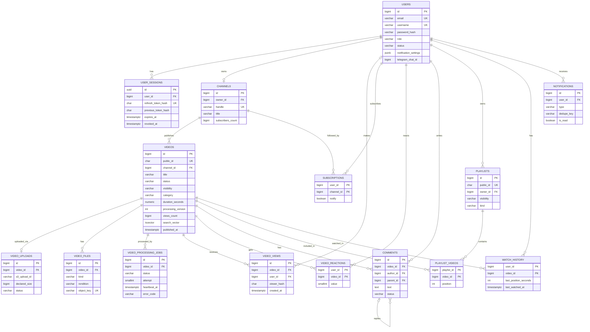

## 3.4. Backend Architecture

### Модули

Каждый модуль — отдельный Python-пакет внутри приложения с одинаковой внутренней структурой. Модуль владеет своими таблицами; другие модули обращаются к нему только через его сервис, а не через его репозиторий или модели напрямую.

| Модуль | Ответственность |
| --- | --- |
| core | Конфигурация, подключение к БД, Redis, S3-клиенты, безопасность (JWT, хеширование), логирование, ошибки, пагинация, rate limiting |
| auth | Регистрация, вход, сессии, токены |
| users | Профиль, аватар, настройки, приватность |
| channels | Каналы, страница канала |
| subscriptions | Подписки, лента подписок |
| uploads | Multipart-загрузка, presigned URL |
| videos | Видео, статусы, видимость, выдача информации и доступа к воспроизведению |
| processing | Задачи обработки, FFprobe и FFmpeg, пайплайн, подметальщики |
| views | Учёт просмотров, позиция, сброс счётчиков |
| reactions | Лайки и дизлайки |
| comments | Комментарии и модерация |
| playlists | Плейлисты, «Смотреть позже» |
| history | История просмотров |
| search | Поиск и подсказки |
| recommendations | Лента, «Далее», тренды |
| studio | Агрегирующие запросы для Creator Studio (использует сервисы других модулей) |
| notifications | Уведомления, Telegram |
| admin | Модерация |

Внутри модуля — одинаковый набор файлов: роутер (endpoint-ы), схемы (Pydantic), сервис, репозиторий, модели (SQLAlchemy), политики доступа, задачи (Celery), исключения, зависимости. В маленьких модулях часть файлов отсутствует — это нормально.

### Слои и их ответственность

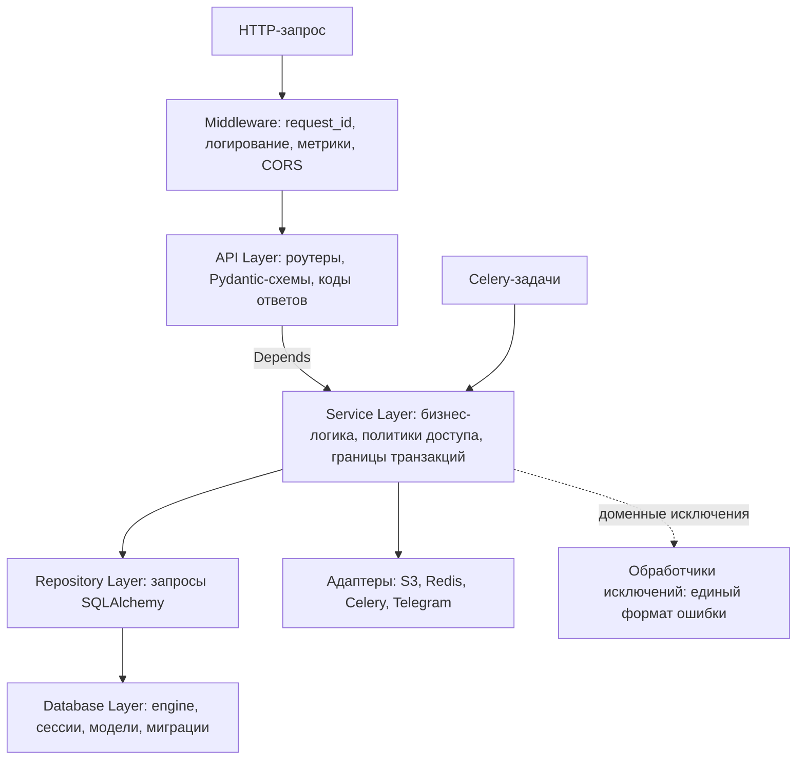

**API Layer (роутеры).** Только HTTP: принять и провалидировать запрос через Pydantic-схему, получить зависимости (текущий пользователь, сервис), вызвать один метод сервиса, вернуть схему ответа с нужным кодом. Здесь нет SQL и нет бизнес-правил. Признак хорошего роутера — функция endpoint-а занимает несколько строк.

**Service Layer.** Вся бизнес-логика: проверки прав через политики доступа, правила (нельзя подписаться на себя, переходы статусов), оркестрация репозиториев и адаптеров. Сервис управляет транзакцией: одна сессия БД на запрос, коммит — в сервисе, в конце бизнес-операции. Задачи Celery, которые нужно отправить, сервис копит в списке «после коммита» и отправляет только после успешного коммита. Сервис бросает доменные исключения и ничего не знает о HTTP.

**Repository Layer.** Доступ к данным: методы с явными названиями («найти видео по публичному идентификатору вместе с каналом», «лента подписок после курсора»). Здесь живут сложные запросы, JOIN-ы, подгрузка связей (против N+1), пагинация. Репозиторий не коммитит и не проверяет права. Универсальный «generic repository» на все таблицы не нужен — это лишняя абстракция; у каждого модуля свой репозиторий только с нужными методами.

**Database Layer.** Асинхронный engine с пулом соединений, фабрика сессий, базовый класс моделей с соглашением об именах ограничений, сами модели (SQLAlchemy 2.0, типизированные поля), миграции Alembic. Для воркеров — отдельный синхронный engine на тех же моделях.

**Адаптеры инфраструктуры.** Тонкие обёртки над внешними системами: S3-хранилище (два клиента — внутренний и для presigned URL), кеш, отправка задач, Telegram. Сервисы зависят от адаптеров, а не от boto3 или Redis напрямую — так в тестах адаптер легко подменить.

**Background Workers.** Celery-приложение в том же пакете. Задачи — тонкие: получить идентификатор, открыть синхронную сессию, вызвать функции сервиса обработки, закрыть сессию. Бизнес-логика не дублируется между async-API и sync-воркерами: «чистые» функции без ввода-вывода (таблица переходов статусов, расчёт лесенки качеств, формула рекомендаций, правила дедупликации) общие для обоих.

### Правила зависимостей

- Направление только сверху вниз: API → Service → Repository → Database.
- Модуль A использует модуль B только через сервис B. Например, `comments` проверяет доступ к видео вызовом сервиса `videos`, а не своим запросом к таблице видео.
- Циклические зависимости между модулями запрещены; если они появляются — общий код выносится в core или связь переворачивается через событие (задачу).

### Обработка исключений

- Иерархия доменных исключений с базовым классом «ошибка приложения». У каждого — машиночитаемый код и HTTP-статус: «не найдено» (404), «доступ запрещён» (403), «не авторизован» (401), «конфликт» (409), «ошибка бизнес-валидации» (422), «слишком много запросов» (429), «сервис недоступен» (503).
- Глобальные обработчики FastAPI превращают их в единый формат ответа: код, сообщение, детали (необязательно), request\_id.
- Ошибки валидации Pydantic тоже приводятся к этому формату со списком полей.
- Нарушение уникальности в базе превращается в конфликт с понятным кодом (например, `HANDLE_TAKEN`) на уровне сервиса.
- Непредвиденное исключение — 500 с общим текстом без деталей; полный стек-трейс уходит в лог с request\_id.
- В воркерах исключения классифицируются на временные и постоянные (см. 2.4).

### Dependency Injection

Используется встроенный механизм Depends в FastAPI; отдельный DI-фреймворк не нужен. Зависимости:

- настройки (создаются один раз и кешируются);
- сессия БД на запрос: открывается в начале, при исключении откатывается, закрывается в конце;
- текущий пользователь: обязательный, необязательный (для гостевых endpoint-ов), требование роли администратора;
- сервисы, собранные из сессии и адаптеров;
- зависимости rate limiting для отдельных endpoint-ов.

В тестах любая зависимость подменяется (например, хранилище — на фейк), не трогая код приложения.

### Валидация данных

Три уровня, у каждого своя задача:

1. **Pydantic — форма данных.** Отдельные схемы на вход (создание, изменение) и на выход (чтение). Входные схемы запрещают лишние поля, задают длины, шаблоны, диапазоны, перечисления. Выходная схема — гарантия, что наружу не уйдёт лишнее (например, хеш пароля), даже если ORM-модель его содержит.
2. **Сервис — бизнес-правила.** Состояние объекта, права, лимиты, квоты, уникальность с понятной ошибкой.
3. **База данных — инварианты.** Уникальные индексы, внешние ключи, CHECK. Последняя линия защиты на случай гонок и ошибок в коде.

### Асинхронность: что нельзя делать в event loop

- CPU-тяжёлые операции (хеширование паролей, обработка изображений Pillow) — в пуле потоков.
- Блокирующие сетевые вызовы boto3 (создание и завершение multipart-загрузки, ListParts, удаление объектов) — тоже в пуле потоков. Генерация presigned URL — локальное вычисление подписи, сеть не нужна.
- Транскодирование — никогда не в API, только в воркерах.

## 3.5. API Design

### Общие соглашения

- Все пути начинаются с `/api/v1`; ниже префикс опущен. Версия в пути позволяет позже выпустить v2, не ломая клиентов.
- Формат — JSON, даты — ISO 8601 в UTC, идентификаторы — строки.
- **Ответ со списком:** массив элементов и курсор следующей страницы (пустой, если страниц больше нет). Параметры запроса — курсор и лимит (по умолчанию 20, максимум 50).
- **Ошибка:** HTTP-код, код ошибки, сообщение, необязательные детали, request\_id.
- **Идемпотентность:** POST-запросы создания принимают заголовок Idempotency-Key.
- **Rate limit:** при превышении — 429 с заголовком Retry-After.
- **Доступ:** «Гость» — без токена; «Пользователь» — нужен access-токен; «Владелец» — пользователь, которому принадлежит объект; «Админ» — роль admin. Для гостевых endpoint-ов токен необязателен, но если он передан — ответ персонализируется.
- Swagger UI доступен в окружении разработки; в продакшене — закрыт или только для администратора.

### Authentication

| Метод | URL | Назначение | Принимает | Возвращает | Доступ |
| --- | --- | --- | --- | --- | --- |
| POST | /auth/register | Регистрация | email, username, display\_name, password | Профиль и access-токен; refresh в cookie | Гость |
| POST | /auth/login | Вход | email, password | Профиль и access-токен; refresh в cookie | Гость |
| POST | /auth/refresh | Обновить токены | refresh-cookie | Новый access-токен; новая cookie | Cookie |
| POST | /auth/logout | Выход | — | 204 | Пользователь |
| POST | /auth/logout-all | Выход со всех устройств | — | 204 | Пользователь |
| GET | /auth/sessions | Активные сессии | — | Список: устройство, IP, последняя активность, текущая ли | Пользователь |
| DELETE | /auth/sessions/{session\_id} | Завершить сессию | — | 204 | Владелец |
| POST | /auth/password/change | Смена пароля | текущий и новый пароль | 204; другие сессии отозваны | Пользователь |

### Users

| Метод | URL | Назначение | Принимает | Возвращает | Доступ |
| --- | --- | --- | --- | --- | --- |
| GET | /users/me | Свой профиль | — | Профиль, канал (если есть), настройки | Пользователь |
| PATCH | /users/me | Изменить профиль | display\_name, bio, username, флаги приватности, пауза истории | Профиль | Пользователь |
| PUT | /users/me/avatar | Загрузить аватар | изображение (multipart/form-data, до 5 МБ) | URL аватара в нескольких размерах | Пользователь |
| DELETE | /users/me/avatar | Удалить аватар | — | 204 | Пользователь |
| PATCH | /users/me/notification-settings | Настройки уведомлений | включение по типам и каналам доставки | Настройки | Пользователь |
| GET | /users/me/subscriptions | Мои подписки | курсор | Список каналов с флагом notify | Пользователь |
| GET | /users/{username}/subscriptions | Подписки другого пользователя | курсор | Список каналов, если открыт | Гость |
| POST | /users/me/telegram/link | Начать привязку Telegram | — | Ссылка на бота с одноразовым токеном | Пользователь |
| DELETE | /users/me/telegram | Отвязать Telegram | — | 204 | Пользователь |

### Channels

| Метод | URL | Назначение | Принимает | Возвращает | Доступ |
| --- | --- | --- | --- | --- | --- |
| POST | /channels | Создать канал | handle, title, description | Канал | Пользователь без канала |
| GET | /channels/{handle} | Шапка канала | — | Название, аватар, баннер, описание, счётчики, «вы подписаны» | Гость |
| PATCH | /channels/me | Изменить канал | title, description, handle, hide\_subscriber\_count | Канал | Владелец |
| PUT | /channels/me/banner | Загрузить баннер | изображение | URL баннера | Владелец |
| GET | /channels/{handle}/videos | Видео канала | сортировка (new, popular, old), курсор | Карточки видео | Гость |
| GET | /channels/{handle}/playlists | Плейлисты канала | курсор | Публичные плейлисты владельца | Гость |

### Videos

| Метод | URL | Назначение | Принимает | Возвращает | Доступ |
| --- | --- | --- | --- | --- | --- |
| GET | /videos/{video\_id} | Страница видео | — | Метаданные, канал, счётчики, моя реакция, подписка, позиция, данные воспроизведения, токен просмотра | Гость; приватное — владелец |
| GET | /videos/trending | Тренды | категория, курсор | Карточки видео | Гость |
| GET | /videos/categories | Список категорий | — | Коды и названия | Гость |

### Uploads

| Метод | URL | Назначение | Принимает | Возвращает | Доступ |
| --- | --- | --- | --- | --- | --- |
| POST | /uploads | Начать загрузку | имя файла, размер, MIME-тип | video\_id, upload\_id, размер части, число частей | Пользователь с каналом |
| POST | /uploads/{upload\_id}/parts | Подписать части | номера частей и их MD5 | Presigned URL для каждой части, срок действия | Владелец |
| GET | /uploads/{upload\_id} | Состояние для докачки | — | Статус, загруженные части с ETag и размерами | Владелец |
| GET | /uploads/active | Незавершённые загрузки | — | Список: видео, имя файла, размер, прогресс | Пользователь |
| POST | /uploads/{upload\_id}/complete | Завершить загрузку | список номеров частей и ETag | 202, статус видео QUEUED | Владелец |
| DELETE | /uploads/{upload\_id} | Отменить загрузку | — | 204 | Владелец |

### Streaming

Сами плейлисты и сегменты (пути `/hls/…`) отдаёт Nginx, FastAPI в этом не участвует.

| Метод | URL | Назначение | Принимает | Возвращает | Доступ |
| --- | --- | --- | --- | --- | --- |
| GET | /videos/{video\_id}/playback | Обновить доступ к воспроизведению | — | URL master playlist, список качеств; новая подписанная cookie | Тот, кто может смотреть видео |
| POST | /videos/{video\_id}/views | Событие просмотра | токен просмотра, время воспроизведения | 204 (всегда) | Гость |
| POST | /videos/{video\_id}/progress | Позиция просмотра | позиция, длительность | 204 | Пользователь |

### Search

| Метод | URL | Назначение | Принимает | Возвращает | Доступ |
| --- | --- | --- | --- | --- | --- |
| GET | /search | Поиск | q, upload\_date, duration, sort, channel, курсор или страница | До 3 каналов и карточки видео | Гость |
| GET | /search/suggestions | Подсказки | q | До 8 строк | Гость |

### Comments

| Метод | URL | Назначение | Принимает | Возвращает | Доступ |
| --- | --- | --- | --- | --- | --- |
| GET | /videos/{video\_id}/comments | Комментарии верхнего уровня | sort (top, new), курсор | Комментарии с авторами и числом ответов | Гость |
| POST | /videos/{video\_id}/comments | Новый комментарий | текст; заголовок Idempotency-Key | Комментарий | Пользователь |
| GET | /comments/{comment\_id}/replies | Ответы | курсор | Ответы | Гость |
| POST | /comments/{comment\_id}/replies | Ответить | текст, reply\_to\_user\_id; Idempotency-Key | Ответ | Пользователь |
| PATCH | /comments/{comment\_id} | Изменить | текст | Комментарий | Автор |
| DELETE | /comments/{comment\_id} | Удалить | — | 204 | Автор, владелец видео, админ |
| PUT | /comments/{comment\_id}/pin | Закрепить | — | Комментарий | Владелец видео |
| DELETE | /comments/{comment\_id}/pin | Открепить | — | 204 | Владелец видео |

### Reactions

| Метод | URL | Назначение | Принимает | Возвращает | Доступ |
| --- | --- | --- | --- | --- | --- |
| PUT | /videos/{video\_id}/reaction | Поставить или сменить реакцию | value: like или dislike | Моя реакция, число лайков | Пользователь |
| DELETE | /videos/{video\_id}/reaction | Снять реакцию | — | Число лайков | Пользователь |
| GET | /users/me/liked-videos | Понравившиеся | курсор | Карточки видео | Пользователь |

### Subscriptions

| Метод | URL | Назначение | Принимает | Возвращает | Доступ |
| --- | --- | --- | --- | --- | --- |
| PUT | /channels/{handle}/subscription | Подписаться | notify (необязательно) | Подписан, число подписчиков | Пользователь |
| PATCH | /channels/{handle}/subscription | «Колокольчик» | notify | Состояние | Подписчик |
| DELETE | /channels/{handle}/subscription | Отписаться | — | Число подписчиков | Пользователь |
| GET | /feed/subscriptions | Лента подписок | курсор | Карточки видео | Пользователь |

### Playlists

| Метод | URL | Назначение | Принимает | Возвращает | Доступ |
| --- | --- | --- | --- | --- | --- |
| POST | /playlists | Создать | title, description, visibility; Idempotency-Key | Плейлист | Пользователь |
| GET | /users/me/playlists | Мои плейлисты | video\_id (необязательно — пометить, где видео уже есть) | Список с флагом «содержит видео» | Пользователь |
| GET | /playlists/{playlist\_id} | Плейлист | — | Данные, владелец, число видео | По видимости |
| GET | /playlists/{playlist\_id}/videos | Видео плейлиста | курсор | Видео в порядке позиций, число недоступных | По видимости |
| PATCH | /playlists/{playlist\_id} | Изменить | title, description, visibility | Плейлист | Владелец |
| DELETE | /playlists/{playlist\_id} | Удалить | — | 204 (кроме «Смотреть позже») | Владелец |
| PUT | /playlists/{playlist\_id}/videos/{video\_id} | Добавить видео | — | Позиция | Владелец |
| PATCH | /playlists/{playlist\_id}/videos/{video\_id} | Переместить | новая позиция | Новый порядок | Владелец |
| DELETE | /playlists/{playlist\_id}/videos/{video\_id} | Убрать видео | — | 204 | Владелец |
| GET | /users/me/watch-later | «Смотреть позже» | курсор | Видео | Пользователь |

### History

| Метод | URL | Назначение | Принимает | Возвращает | Доступ |
| --- | --- | --- | --- | --- | --- |
| GET | /history | История | курсор | Видео с позицией и временем просмотра | Пользователь |
| GET | /history/continue | «Продолжить просмотр» | — | До 20 недосмотренных видео | Пользователь |
| DELETE | /history/{video\_id} | Удалить запись | — | 204 | Пользователь |
| DELETE | /history | Очистить историю | — | 204 | Пользователь |

Пауза истории включается через изменение профиля.

### Recommendations

| Метод | URL | Назначение | Принимает | Возвращает | Доступ |
| --- | --- | --- | --- | --- | --- |
| GET | /feed/home | Главная лента | курсор | Карточки видео с причиной рекомендации | Гость (тренды) или пользователь |
| GET | /videos/{video\_id}/related | Список «Далее» | лимит | Карточки видео | Гость |

### Creator Studio

Все endpoint-ы требуют, чтобы пользователь был владельцем канала и видео.

| Метод | URL | Назначение | Принимает | Возвращает |
| --- | --- | --- | --- | --- |
| GET | /studio/dashboard | Сводка канала | — | Подписчики, просмотры за 28 дней, топ видео, последние комментарии |
| GET | /studio/videos | Мои видео | статус, видимость, поиск, сортировка, курсор | Строки таблицы с любыми статусами |
| GET | /studio/videos/{video\_id} | Видео для редактирования | — | Все поля, кандидаты обложек, история задач обработки |
| PATCH | /studio/videos/{video\_id} | Изменить видео | title, description, tags, category, visibility, comments\_enabled | Видео |
| PUT | /studio/videos/{video\_id}/thumbnail | Сменить обложку | идентификатор кандидата или изображение | URL обложки |
| GET | /studio/videos/{video\_id}/processing | Состояние обработки | — | Статус, этап, процент, ошибка |
| POST | /studio/videos/{video\_id}/reprocess | Повторить обработку | — | 202, QUEUED (только для временных ошибок) |
| DELETE | /studio/videos/{video\_id} | Удалить видео | — | 204 |
| GET | /studio/videos/{video\_id}/analytics | Статистика видео | период: 7, 28 или 90 дней | Ряды по дням и итоговые показатели |
| GET | /studio/analytics | Статистика канала | период | Ряды и итоги |
| GET | /studio/comments | Комментарии канала | video\_id, курсор | Комментарии |
| GET | /studio/subscribers | Подписчики | курсор | Пользователи и даты подписки |

### Notifications

| Метод | URL | Назначение | Принимает | Возвращает | Доступ |
| --- | --- | --- | --- | --- | --- |
| GET | /notifications | Список | курсор | Уведомления | Пользователь |
| GET | /notifications/unread-count | Число непрочитанных | — | Число | Пользователь |
| POST | /notifications/{notification\_id}/read | Отметить прочитанным | — | 204 | Пользователь |
| POST | /notifications/read-all | Прочитать все | — | 204 | Пользователь |
| POST | /integrations/telegram/webhook | События от Telegram | update от Telegram | 200 | Секретный заголовок Telegram |

### Служебные и администрирование

| Метод | URL | Назначение | Доступ |
| --- | --- | --- | --- |
| GET | /health/live | Процесс жив | Внутренний |
| GET | /health/ready | Готов принимать запросы: БД и Redis доступны | Внутренний |
| GET | /metrics | Метрики Prometheus | Только внутренняя сеть |
| GET | /admin/videos | Видео по статусу (например, FAILED) с деталями ошибок | Админ |
| POST | /admin/videos/{video\_id}/hide | Скрыть или вернуть видео | Админ |
| POST | /admin/comments/{comment\_id}/hide | Скрыть комментарий | Админ |
| POST | /admin/users/{user\_id}/ban | Заблокировать или разблокировать пользователя | Админ |
