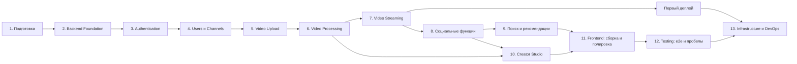

# Часть V. Последовательность реализации

Этапы идут в порядке технических зависимостей: каждый следующий опирается на работающий результат предыдущего. Внутри каждого этапа указан порядок задач, критерии завершения и тесты. Оценки времени — в Части IX.

## Три принципа, которые меняют порядок из задания

1. **Тесты и CI — с этапа 2, а не в конце.** Этап 12 в этом плане — не «написать тесты», а добавить e2e, нагрузочные проверки и закрыть пробелы. Тесты, отложенные на конец, не пишутся никогда.
2. **Фронтенд — параллельно с backend.** Каждый backend-этап заканчивается минимальным экраном, который его использует. Этап 11 — это полировка и сборка цельного интерфейса, а не начало фронтенда с нуля.
3. **Первый деплой — сразу после этапа 7.** Как только видео загружается и проигрывается, проект выкладывается на VPS в минимальной конфигурации. Проблемы продакшена (HTTPS, presigned URL на публичном домене, CORS, размер тел) лучше найти рано. Этап 13 доводит инфраструктуру до production-уровня: мониторинг, бэкапы, автоматический деплой.

## Карта зависимостей

Строго последовательны этапы 1–7: без авторизации нельзя загрузить видео, без загрузки нечего обрабатывать, без обработки нечего проигрывать. После этапа 7 часть работы можно вести параллельно (см. конец Части V).

## Этап 1. Подготовка проекта

**Цель.** Из пустого репозитория получить окружение, которое поднимается одной командой: все инфраструктурные сервисы работают, FastAPI отвечает, React-страница открывается.

**Задачи в порядке выполнения:**

1. Создать репозиторий, .gitignore (Python, Node, .env, тома), .editorconfig. Защитить ветку main: изменения только через pull request (даже если вы один — это дисциплина и история).
2. Создать структуру директорий из Части IV (пустые пакеты).
3. Backend: проект через uv, FastAPI-приложение с endpoint-ом проверки здоровья, запуск локально.
4. Dockerfile для backend (пока одна цель, без FFmpeg), запуск в контейнере.
5. Docker Compose: PostgreSQL 16, Redis 7, хранилище S3, API. Для каждого — проверка здоровья; API стартует, только когда база и Redis здоровы. Данные — в именованных томах.
6. Скрипт инициализации бакетов (originals, hls, images) с политиками и CORS.
7. Frontend: проект Vite с React, TypeScript и Tailwind; токены цветов и шрифт с кириллицей.
8. Nginx в Compose уже на этом этапе: «/» — на dev-сервер Vite, «/api» — на FastAPI. Один origin с первого дня избавляет от проблем с CORS и cookie.
9. Makefile: поднять, остановить, логи, оболочка в контейнере, тесты.
10. .env.example со всеми переменными; pre-commit с Ruff.
11. README: описание, как запустить.

**Зависимости.** Нет.

**Результат.** Команда «make up» поднимает все сервисы; в браузере открывается страница, которая запрашивает /api/v1/health и показывает «ok».

**Критерии завершения:**

- [ ] Свежий клон репозитория запускается за 10 минут по README.
- [ ] Все контейнеры в состоянии healthy.
- [ ] В репозитории нет секретов; .env в .gitignore.
- [ ] Pre-commit срабатывает при коммите.

**Типичные ошибки:** коммит .env; образы с тегом latest вместо фиксированной версии; depends\_on без условия здоровья (API падает, пока база стартует); порты PostgreSQL и Redis, открытые на всех интерфейсах; node\_modules хоста, смонтированные в контейнер.

**Сложность:** низкая.

**Тесты:** один smoke-тест endpoint-а здоровья через HTTPX. Минимальный CI: Ruff и pytest на каждый push.

## Этап 2. Backend Foundation

**Цель.** Каркас backend, к которому модули добавляются по одному шаблону, с тестовой инфраструктурой на настоящей базе.

**Задачи в порядке выполнения:**

1. Конфигурация через pydantic-settings: группы настроек (БД, Redis, хранилище, безопасность), окружения dev, test, prod.
2. Асинхронный engine SQLAlchemy, фабрика сессий, зависимость «сессия на запрос» с откатом при ошибке.
3. Базовый класс моделей с соглашением об именах ограничений; общие поля created\_at и updated\_at.
4. Alembic: окружение, которое видит все модели; первая пустая миграция; миграции применяются командой в контейнере.
5. Логирование structlog в JSON; middleware, которое присваивает каждому запросу request\_id, кладёт его в контекст логов и в заголовок ответа.
6. Иерархия доменных исключений, глобальные обработчики, единый формат ошибки, приведение ошибок валидации к нему.
7. Утилиты пагинации: кодирование и декодирование курсора, общая схема ответа со списком.
8. Адаптеры Redis и S3 (внутренний клиент и клиент для presigned URL).
9. Тестовая инфраструктура: pytest, testcontainers для PostgreSQL и Redis, применение миграций к тестовой базе, изоляция тестов (каждый тест в откатываемой транзакции или очистка таблиц), фабрики данных, HTTPX-клиент.
10. Пробный модуль, проходящий через все слои, — эталон для остальных.
11. CI: Ruff, mypy, pytest с сервисами; отчёт о покрытии.

**Зависимости.** Этап 1.

**Результат.** Готовый каркас: новый модуль добавляется копированием шаблона.

**Критерии завершения:**

- [ ] Миграции применяются с нуля и откатываются.
- [ ] Автогенерация миграции на неизменённых моделях даёт пустой результат.
- [ ] Любая ошибка API возвращается в едином формате с request\_id.
- [ ] Тесты идут на настоящем PostgreSQL, CI зелёный.

**Типичные ошибки:** Alembic не импортирует модели и «не видит» таблицы; коммит внутри репозитория; глобальная сессия на всё приложение; синхронные вызовы внутри async-функций; тесты на SQLite; отсутствие соглашения об именах — потом ограничения невозможно удалить миграцией.

**Сложность:** средняя.

**Тесты:** unit — кодирование курсора; integration — сессия и откат транзакции; api — формат ошибки 404 и 422, наличие request\_id в ответе.

## Этап 3. Authentication

**Цель.** Полноценная авторизация, на которую опираются все остальные модули.

**Задачи в порядке выполнения:**

1. Модели users и user\_sessions, миграция.
2. Хеширование паролей Argon2id в пуле потоков, список распространённых паролей.
3. Регистрация.
4. Вход: проверка пароля, создание сессии, выпуск access-токена, refresh-cookie.
5. Зависимости «текущий пользователь» (обязательный и необязательный), проверка роли.
6. Обновление токенов с ротацией, окном гонки и обнаружением повторного использования.
7. Выход, выход со всех устройств, Redis-список отозванных sid.
8. Список сессий и завершение сессии; смена пароля.
9. Rate limiting на Redis для входа и регистрации; лимит в Nginx.
10. Скрипт создания администратора.
11. **Фронтенд параллельно:** страницы входа и регистрации; HTTP-клиент, который хранит access-токен в памяти, при 401 TOKEN\_EXPIRED обновляет его одним запросом на все вкладки и повторяет исходный запрос; защищённые маршруты; восстановление сессии при открытии сайта.

**Зависимости.** Этап 2.

**Результат.** Регистрация, вход, автоматическое обновление токена и выход работают через интерфейс.

**Критерии завершения:**

- [ ] После выхода старый access-токен перестаёт работать сразу.
- [ ] Повторное использование старого refresh-токена отзывает сессию.
- [ ] Две вкладки одновременно обновляют токен без выхода из аккаунта.
- [ ] Шестая неверная попытка входа подряд блокируется.

**Типичные ошибки:** refresh-токен в localStorage; access-токен на сутки; алгоритм подписи берётся из заголовка токена; разные сообщения для «нет такого email» и «неверный пароль»; refresh хранится в базе открытым текстом; Argon2 блокирует event loop; неверные флаги cookie (путь, SameSite), из-за которых браузер не присылает её.

**Сложность:** средняя, местами высокая (ротация и гонки).

**Тесты:** unit — хеширование, выпуск и проверка токенов, истечение. API — регистрация (успех, дубль email в другом регистре, слабый пароль), вход (неверный пароль, заблокированный пользователь, rate limit), обновление (ротация, гонка 409, повторное использование 401 и отзыв), выход делает access-токен недействительным, защищённый endpoint без токена — 401.

## Этап 4. Users и Channels

**Цель.** Профили, каналы и подписки — всё, что нужно до загрузки видео.

**Задачи в порядке выполнения:**

1. Профиль: получение и изменение, ограничение частоты смены username.
2. Загрузка аватара: потоковое чтение с лимитом, проверка Pillow, ресайз, WebP, версионный путь в хранилище, удаление старых версий фоновой задачей (здесь впервые подключается Celery с очередью default).
3. Раздача изображений через Nginx из бакета images с кешем.
4. Модель channels, создание канала, проверка handle (формат, зарезервированные слова, уникальность без учёта регистра).
5. Страница канала, изменение канала, баннер.
6. Модель subscriptions, идемпотентные подписка и отписка с атомарными счётчиками, список подписчиков для владельца, «колокольчик».
7. Флаги приватности.
8. **Фронтенд параллельно:** настройки профиля с аватаром, форма создания канала, шапка страницы канала, кнопка подписки с оптимистичным обновлением.

**Зависимости.** Этап 3.

**Результат.** Пользователь создаёт канал, загружает аватар; другой пользователь подписывается.

**Критерии завершения:**

- [ ] 20 параллельных запросов подписки дают счётчик 1.
- [ ] Файл, переименованный в .jpg, но не являющийся изображением, отклоняется.
- [ ] После смены аватара новая картинка видна сразу, без очистки кеша.

**Типичные ошибки:** доверие Content-Type от клиента; нет ограничения числа пикселей; один и тот же ключ для нового аватара (старый висит в кешах); счётчик через «прочитать — прибавить — записать»; подписка на собственный канал; handle совпадает с маршрутом фронтенда.

**Сложность:** средняя.

**Тесты:** API — правила создания канала, уникальность handle в разных регистрах; аватар: корректный, повреждённый, слишком большой по размеру и по пикселям; идемпотентность подписки; конкурентный тест счётчика; приватность списка подписок.

## Этап 5. Video Upload

**Цель.** Надёжная загрузка больших файлов напрямую в хранилище с докачкой.

**Задачи в порядке выполнения:**

1. Модели videos (пока основные поля и статусы), video\_uploads, video\_files; миграция.
2. Доменная функция смены статуса видео с таблицей разрешённых переходов — до любых endpoint-ов, с unit-тестами.
3. Генератор публичных идентификаторов.
4. Endpoint инициализации: права, лимиты, квоты, создание multipart-загрузки.
5. Публичный S3-клиент для presigned URL; Nginx-поддомен для загрузок (локально — отдельный хост вроде s3.localhost), запрет GET и HEAD на нём; CORS на бакете с открытым заголовком ETag.
6. Endpoint подписи частей с MD5 в подписи.
7. Endpoint состояния через ListParts.
8. Endpoint завершения: сверка частей и ETag, завершение, сверка размера, транзакция UPLOADED с записью оригинала. Пока без постановки задачи обработки — она появится на этапе 6.
9. Отмена загрузки.
10. Задача Beat для брошенных загрузок; правило жизненного цикла бакета.
11. **Фронтенд параллельно:** диалог загрузки (Uppy с модулем S3 Multipart, подключённым к своим endpoint-ам, или собственный загрузчик): прогресс, пауза, продолжение, повтор частей, восстановление по отпечатку файла из localStorage; после загрузки — форма названия, описания и видимости.

**Зависимости.** Этап 4 (нужен канал), этап 2 (S3-адаптер).

**Результат.** Файл в несколько гигабайт загружается в хранилище, переживает обрыв сети и перезагрузку страницы.

**Критерии завершения:**

- [ ] Файл 2 ГБ загружается полностью; при отключении сети на минуту загрузка продолжается сама.
- [ ] После закрытия вкладки загрузка продолжается с места остановки при повторном выборе файла.
- [ ] Неверный ETag или несовпадение размера отклоняются.
- [ ] Другой пользователь не может подписать части чужой загрузки.
- [ ] Брошенная загрузка удаляется автоматически.
- [ ] Во время загрузки API не нагружен (проверить в мониторинге контейнера).

**Типичные ошибки:** presigned URL подписан внутренним адресом MinIO (SignatureDoesNotMatch в браузере); CORS не открывает ETag; часть меньше 5 МиБ; имя файла пользователя в ключе объекта; нет правила удаления незавершённых загрузок; состояние частей хранится только в браузере; истечение URL не обрабатывается.

**Сложность:** высокая.

**Тесты:** unit — переходы статусов, расчёт числа частей. Integration с хранилищем в testcontainers: полный цикл multipart, где тест играет роль браузера и загружает части по presigned URL через HTTPX; докачка через ListParts; завершение с неверным ETag; несовпадение размера; отмена; превышение квоты; попытка доступа к чужой загрузке.

## Этап 6. Video Processing

**Цель.** Фоновый пайплайн, превращающий оригинал в HLS-лесенку с обложками, устойчивый к сбоям и повторам.

**Задачи в порядке выполнения:**

1. Цель сборки worker в Dockerfile с FFmpeg фиксированной версии; сервис worker-video в Compose с лимитами CPU и памяти и отдельным томом для временных файлов.
2. Настройка Celery: очереди video, default, notifications; маршрутизация задач; JSON-сериализация; подтверждение после выполнения; prefetch 1; visibility timeout больше максимального времени обработки; мягкий и жёсткий лимиты времени; перезапуск процесса после N задач. Сервис Celery Beat.
3. Модель video\_processing\_jobs с частичным уникальным индексом; создание задачи в транзакции завершения загрузки; отправка в очередь после коммита.
4. **Вертикальный срез:** захват задачи → скачивание → FFprobe → **одно качество 360p** → загрузка в хранилище → master playlist → финализация READY. Пока без обложек и без остальных качеств. Цель — как можно раньше получить сквозной путь.
5. Разбор вывода FFprobe и валидация метаданных с понятными кодами ошибок.
6. Расчёт лесенки качеств (чистая функция) и остальные качества; выравнивание ключевых кадров.
7. Обложки: три кадра-кандидата, два размера.
8. Прогресс в Redis; сердцебиение задачи.
9. Классификация ошибок, повторы с экспоненциальной задержкой, сохранение ошибки и хвоста stderr.
10. Подметальщики Beat: зависшие задачи, неотправленные задачи в QUEUED.
11. Условная финализация; проверка, что удаление видео во время обработки не ломается.
12. Защита FFmpeg: белый список протоколов (только файлы), запуск со списком аргументов без shell, непривилегированный пользователь, отсутствие сети у контейнера воркера (кроме доступа к внутренним сервисам).
13. **Фронтенд параллельно:** после загрузки — индикатор обработки с этапом и процентом (опрос endpoint-а статуса), сообщение об ошибке.

**Зависимости.** Этап 5.

**Результат.** Загруженное видео автоматически превращается в набор HLS-качеств с обложкой и переходит в READY.

**Критерии завершения:**

- [ ] Набор тестовых файлов даёт ожидаемый результат: горизонтальное, вертикальное, снятое на телефон с поворотом, без звука, 60 кадров в секунду, 4K, очень короткое — READY; повреждённое и не-видео с расширением .mp4 — FAILED с понятным кодом.
- [ ] Убийство воркера посреди обработки — задача восстанавливается и завершается.
- [ ] Двойная доставка одной задачи — видео обрабатывается один раз.
- [ ] Во время транскодирования API отвечает без заметной задержки.
- [ ] После любой задачи временная директория пуста.

**Типичные ошибки:** задача ставится до коммита; в аргументы задачи передаются большие данные; visibility timeout меньше времени обработки; параллелизм воркера больше числа ядер; ключевые кадры не выровнены (рывки при смене качества); апскейл маленьких видео; игнорирование поворота; видео без аудиодорожки ломает команду FFmpeg; временные файлы забивают диск; зависание из-за переполненного буфера при чтении вывода FFmpeg (читайте stderr непрерывно или пишите в файл); команда собирается строкой через shell.

**Сложность:** очень высокая — самый сложный этап проекта.

**Тесты:** unit — лесенка для разных разрешений и пропорций, разбор сохранённых JSON-выводов FFprobe, классификация ошибок, переходы статусов. Worker-тесты с настоящим FFmpeg на роликах длиной 2–3 секунды: в хранилище появились ожидаемые плейлисты, сегменты и обложки; master playlist содержит нужные качества; повторный запуск задачи не меняет результат; повреждённый файл даёт FAILED с кодом; имитация сбоя хранилища даёт повтор с номером попытки 2.

## Этап 7. Video Streaming

**Цель.** Видео проигрывается в браузере с адаптивным качеством, перемоткой и защитой доступа; затем — первый деплой.

**Задачи в порядке выполнения:**

1. Nginx: location для HLS — проксирование в бакет hls по внутренней сети, дисковый кеш (размер, срок неактивности, кешировать только успешные ответы), блокировка кеша, правильные типы содержимого, Cache-Control для неизменяемых путей, скрытие служебных заголовков хранилища, заголовок статуса кеша для отладки.
2. Модуль secure\_link: формат подписи и времени истечения, секрет из переменной окружения, общий для backend и Nginx.
3. Backend: endpoint информации о видео с правилами доступа; выдача подписанной cookie; endpoint продления доступа.
4. **Фронтенд:** страница просмотра; плеер на hls.js с нативным HLS в Safari; постер из обложки; ручной выбор качества и режим «Авто»; восстановление после ошибок; горячие клавиши; продолжение с сохранённой позиции (позиция появится на этапе 8, заложите место).
5. Проверка адаптивного битрейта через ограничение сети в инструментах разработчика браузера; проверка перемотки.
6. **Первый деплой (минимальный):** VPS — пользователь без root, вход только по SSH-ключу, firewall с открытыми 22, 80 и 443; Docker; домен и DNS (основной домен и поддомен загрузок); продакшен-Compose без лишних портов; HTTPS через Let's Encrypt; секреты в .env на сервере; применение миграций; проверка загрузки и просмотра на реальном домене.

**Зависимости.** Этап 6.

**Результат.** Работающий видеохостинг на публичном домене: загрузить, дождаться обработки, посмотреть.

**Критерии завершения:**

- [ ] Видео играет в Chrome, Firefox, на мобильном; в Safari — если есть устройство.
- [ ] При ограничении сети качество снижается без остановки, при восстановлении — растёт.
- [ ] Перемотка в середину часового видео начинает воспроизведение за 1–2 секунды.
- [ ] Сегмент без cookie или с истёкшей cookie — 403.
- [ ] Повторный запрос сегмента отдаётся из кеша Nginx; FastAPI не получает запросов к сегментам.
- [ ] Прямое чтение бакетов через поддомен загрузок невозможно.
- [ ] Сайт работает по HTTPS на домене.

**Типичные ошибки:** неверные MIME-типы (воспроизведение ломается в части браузеров); сжатие сегментов; кеширование ошибок 403 и 404; бакет HLS доступен напрямую снаружи; путь cookie не совпадает с путём сегментов; backend и Nginx по-разному кодируют подпись (например, base64 с выравниванием и без); на продакшене presigned URL указывают на внутренний адрес; Nginx отклоняет загрузку частей из-за лимита размера тела на поддомене загрузок.

**Сложность:** высокая.

**Тесты:** API — cookie выдаётся только тем, кому разрешён просмотр; чужое приватное видео — 404. Smoke-скрипт против поднятого Compose (в CI): сегмент без cookie — 403, с верной — 200, с истёкшей — 403; повторный запрос — попадание в кеш.

## Этап 8. Основные социальные функции

**Цель.** Превратить «плеер» в платформу: реакции, просмотры, история, комментарии, плейлисты, лента подписок.

**Задачи в порядке выполнения** (от простого к сложному; первая задача задаёт шаблон счётчиков для остальных):

1. Реакции: модель, идемпотентные PUT и DELETE, атомарные счётчики.
2. Учёт просмотров: токен просмотра, дедупликация в Redis, лимит по IP, накопление дельт, задача Beat для пакетного сброса, модель video\_views.
3. Позиция и история: endpoint сердцебиения с upsert, история с пагинацией, удаление и очистка, пауза, полка «Продолжить просмотр».
4. Комментарии: создание с ключом идемпотентности и rate limit, список верхнего уровня, ответы, редактирование, мягкое удаление, закрепление, отключение комментариев; загрузка авторов без N+1.
5. Плейлисты: CRUD, добавление и удаление с блокировкой плейлиста, перемещение, «Смотреть позже», «Понравившиеся».
6. Лента подписок (модель подписок уже есть с этапа 4).
7. Уведомления в интерфейсе: модель, задачи создания с ключами дедупликации, счётчик непрочитанных, endpoint-ы списка и прочтения. Telegram — после MVP.
8. Ночная сверка денормализованных счётчиков.
9. **Фронтенд параллельно:** кнопки лайка и дизлайка, отправка события просмотра и сердцебиений из плеера, блок комментариев с ответами, окно «Сохранить в плейлист», страницы плейлиста, истории и ленты подписок, колокольчик уведомлений.

**Зависимости.** Этап 7 (нужно проигрываемое видео). Этап 4 (подписки).

**Результат.** Пользователи взаимодействуют с видео и друг с другом.

**Критерии завершения:**

- [ ] Обновление страницы видео не увеличивает просмотры; повторный просмотр в течение суток не засчитывается.
- [ ] Двойная отправка формы комментария создаёт один комментарий.
- [ ] Параллельные реакции дают корректные счётчики.
- [ ] Перемещения в плейлисте сохраняют позиции без дырок и дублей.
- [ ] Чужой приватный плейлист недоступен.
- [ ] Список комментариев выполняется фиксированным числом запросов к базе независимо от числа комментариев.

**Типичные ошибки:** просмотр засчитывается при открытии страницы; время просмотра от клиента принимается без проверки токена; N+1 при выводе комментариев; бесконечная вложенность ответов; дубли позиций в плейлисте; уведомление самому себе; счётчик непрочитанных расходится с базой.

**Сложность:** средняя (много функций, каждая умеренной сложности).

**Тесты:** API на каждую функцию, включая права и идемпотентность; конкурентные тесты счётчиков реакций; тест дедупликации просмотров (два события одного зрителя — один просмотр; событие раньше порога — не засчитано); тест сброса дельт в базу; тест на число SQL-запросов при выводе комментариев (счётчик запросов в тестовой сессии); тест перемещения в плейлисте во все стороны.

## Этап 9. Поиск и рекомендации

**Цель.** Пользователь находит видео по словам и получает осмысленную персональную ленту.

**Задачи в порядке выполнения:**

1. Миграция: расширение pg\_trgm, поле поискового вектора, триггер, частичный GIN-индекс, триграммные индексы.
2. Скрипт генерации тестовых данных: 100 тысяч видео-записей без файлов, с реалистичными русскими и английскими названиями, — для проверки производительности.
3. Endpoint поиска: разбор запроса, фильтры, сортировки, курсорная пагинация, поиск каналов, резервный триграммный поиск.
4. Подсказки при вводе.
5. Проверка всех запросов через EXPLAIN ANALYZE на 100 тысячах записей; исправление планов.
6. Кеширование популярных запросов; rate limit.
7. Категории видео (фиксированный список), выбор категории при редактировании.
8. Тренды: задача Beat раз в 15 минут.
9. Рекомендации: профиль интересов, источники кандидатов, функция оценки (чистая функция), разнообразие, кеш в Redis, причины рекомендаций, список «Далее».
10. **Фронтенд параллельно:** строка поиска с подсказками, страница результатов с фильтрами, главная лента с бесконечной прокруткой, колонка «Далее» на странице просмотра.

**Зависимости.** Этап 7 для поиска (нужны готовые видео); этап 8 для рекомендаций (сигналы: история, лайки, подписки).

**Результат.** Работающий поиск с морфологией и опечатками; персональная главная.

**Критерии завершения:**

- [ ] Поиск по 100 тысячам видео отвечает быстрее 100 мс (95-й перцентиль) локально.
- [ ] «котики» находит «котик», запрос с одной опечаткой находит видео.
- [ ] Совпадение в названии ранжируется выше совпадения в описании.
- [ ] Ленты двух пользователей с разной историей различаются; на странице не больше двух видео одного канала.
- [ ] Гость видит тренды.

**Типичные ошибки:** строка сортировки от клиента попадает в запрос; глубокая offset-пагинация; подсчёт общего числа результатов; индекс не частичный или условие запроса не совпадает с условием индекса и индекс не используется; рекомендации считаются на каждый запрос без кеша; признаки не нормированы, и один доминирует; случайность ломает пагинацию.

**Сложность:** средняя, местами высокая.

**Тесты:** integration — ранжирование, морфология, фильтры, стабильность курсора при вставке новых видео; unit — функция оценки, граница Уилсона, затухание свежести, разнообразие; API — лента для гостя и пользователя.

## Этап 10. Creator Studio

**Цель.** Автор управляет всеми видео и каналом из одного кабинета, без Swagger.

**Задачи в порядке выполнения:**

1. Список видео автора со всеми статусами, фильтрами и сортировкой.
2. Редактирование видео; переходы видимости и их побочные эффекты (первая публикация, сброс кешей, счётчики).
3. Выбор обложки из кандидатов и загрузка своей.
4. Состояние обработки, сообщение об ошибке, повторная обработка.
5. Удаление видео с фоновой очисткой хранилища и связанных записей.
6. Статистика видео и канала: запросы по дням, кеширование.
7. Комментарии канала, подписчики, настройки канала.
8. Панель с ключевыми показателями.
9. Минимальная админ-страница: видео в FAILED с деталями, скрытие видео и комментариев, блокировка пользователя.
10. **Фронтенд:** раскладка Studio (боковое меню разделов), таблица видео, страница редактирования, графики статистики (небольшая библиотека графиков, например Recharts, — единственная новая зависимость, без неё графики пришлось бы рисовать вручную).

**Зависимости.** Этап 6 (статусы и ошибки обработки) и этап 8 (комментарии, просмотры). Пункты 1–5 можно начинать сразу после этапа 7.

**Результат.** Полный жизненный цикл видео автора управляется из интерфейса.

**Критерии завершения:**

- [ ] Каждый endpoint Studio для чужого видео отвечает 404.
- [ ] После удаления видео в хранилище не остаётся объектов с его префиксом.
- [ ] Повторное переключение видимости не рассылает уведомления заново.
- [ ] Статистика совпадает с заранее подготовленными данными.

**Типичные ошибки:** Studio переиспользует публичные endpoint-ы и либо не показывает приватное, либо раскрывает его посторонним; удаление файлов синхронно в запросе; запросы статистики без индекса по видео и дате; кеши не сбрасываются после изменений.

**Сложность:** средняя.

**Тесты:** права владельца на каждом endpoint-е; переходы видимости и побочные эффекты; задача удаления очищает хранилище (testcontainers); корректность агрегатов статистики; повторная обработка разрешена только для временных ошибок.

## Этап 11. Frontend: сборка и полировка

**Цель.** Цельный, быстрый и аккуратный интерфейс, который не стыдно показать. Основные экраны к этому моменту уже существуют — их создавали параллельно с backend.

### Что делалось параллельно с backend

| Backend-этап | Экраны, созданные вместе с ним |
| --- | --- |
| 1 | Каркас приложения, токены дизайна, шрифт |
| 3 | Вход, регистрация, HTTP-клиент с обновлением токена, защищённые маршруты |
| 4 | Настройки профиля, создание канала, страница канала, кнопка подписки |
| 5–6 | Диалог загрузки с докачкой, индикатор обработки |
| 7 | Страница просмотра и плеер |
| 8 | Реакции, комментарии, плейлисты, история, лента подписок, уведомления |
| 9 | Поиск, главная лента, «Далее» |
| 10 | Creator Studio |

**Почему не откладывать фронтенд на конец:** endpoint, который ни разу не вызвал реальный интерфейс, почти наверняка неудобен (не те поля, нет нужной пагинации, лишние запросы). Интеграция сразу выявляет такие проблемы, пока контекст свежий.

### Задачи этого этапа в порядке выполнения

1. **Дизайн-система:** довести набор компонентов до единообразия: кнопки, поля, модальные окна, всплывающие уведомления, скелетоны загрузки, пустые состояния, карточка видео в нескольких размерах. Минималистичный стиль, акцентные фиолетовый, оранжевый и зелёный, шрифт с кириллицей.
2. **Раскладка и навигация:** шапка с поиском и колокольчиком, сворачиваемое боковое меню, адаптивность до ширины телефона.
3. **Карта маршрутов:** главная; «/watch/идентификатор»; «/@handle» с вкладками; «/results»; «/playlist/идентификатор»; лента подписок, история, плейлисты; «/studio/…»; настройки; вход и регистрация; страница 404.
4. **Слой данных:** соглашение о ключах запросов TanStack Query; бесконечные запросы для курсорной пагинации; оптимистичные обновления для реакций и подписок; правила инвалидации после изменений. Серверные данные живут только в TanStack Query, не в Zustand.
5. **Ошибки и состояния:** границы ошибок (error boundaries), повтор запроса, понятные сообщения по кодам ошибок API, состояния «загрузка», «пусто», «ошибка» на каждом экране.
6. **Производительность:** раздельная загрузка кода (Studio и hls.js — отдельные чанки), ленивая загрузка обложек, фиксированное соотношение сторон карточек (нет «прыжков» вёрстки), предзагрузка данных при наведении на карточку.
7. **Доступность:** управление плеером с клавиатуры, видимый фокус, подписи кнопок для экранных читалок, достаточный контраст.
8. **Контракт с API:** генерация TypeScript-типов из OpenAPI в CI — если backend изменил схему, сборка фронтенда упадёт.

**Зависимости.** Этапы 9 и 10 для полной сборки; отдельные пункты (дизайн-система, раскладка) — в любой момент.

**Результат.** Все сценарии выполняются через интерфейс на компьютере и телефоне.

**Критерии завершения:**

- [ ] Lighthouse на странице просмотра: производительность выше 80, доступность выше 90.
- [ ] В консоли браузера нет ошибок и предупреждений на основных сценариях.
- [ ] Все экраны пригодны для использования на ширине 375 пикселей.
- [ ] Типы API генерируются, ручных описаний ответов нет.

**Типичные ошибки:** серверные данные копируются в Zustand и расходятся с сервером; запросы не инвалидируются после изменения; токен в localStorage; hls.js в основном бандле; гонка обновления токена между вкладками; карточки без фиксированного соотношения сторон.

**Сложность:** средняя.

**Тесты:** Vitest и React Testing Library для ключевых компонентов: состояние диалога загрузки (пауза, ошибка части, продолжение), форма комментария (блокировка повторной отправки), кнопка реакции (оптимистичное обновление и откат), HTTP-клиент (обновление токена и повтор запроса). API мокается через MSW.

## Этап 12. Testing

**Цель.** Закрыть пробелы и добавить проверки, которые нельзя было сделать раньше: сквозные сценарии, матрица видеофайлов, отказоустойчивость, нагрузка.

### Пирамида тестов проекта

| Уровень | Что проверяет | Инструменты | Когда запускается |
| --- | --- | --- | --- |
| Unit | Чистые функции: переходы статусов, лесенка, оценка рекомендаций, курсоры, токены | pytest | Каждый push, секунды |
| Integration | Репозитории и сервисы с настоящими PostgreSQL, Redis, хранилищем | pytest, testcontainers | Каждый push, минуты |
| API | Endpoint-ы: коды, права, валидация, идемпотентность | pytest, HTTPX | Каждый push |
| Upload | Полный multipart-цикл, докачка, отказы | pytest, HTTPX, хранилище в контейнере | Каждый push |
| Video processing и worker | Пайплайн на настоящем FFmpeg, повторы, идемпотентность, подметальщики | pytest, FFmpeg, testcontainers | Каждый push (короткие ролики) |
| Frontend | Компоненты и логика клиента | Vitest, RTL, MSW | Каждый push |
| End-to-end | Сценарии пользователя на поднятом Compose | Playwright | Pull request в main и ночью |
| Нагрузочные | API и раздача HLS под нагрузкой | k6 или Locust (опционально) | Вручную перед релизом |

**Задачи в порядке выполнения:**

1. Отчёт о покрытии; добить пробелы. Порог в CI: 80% для backend в целом, выше для auth, uploads и processing. Покрытие — ориентир, а не цель: важнее, что проверены пути ошибок.
2. **Матрица тестовых видео без бинарников в Git:** короткие ролики генерируются самим FFmpeg из синтетических источников (тестовая картинка и тон) при запуске тестов — разные разрешения, поворот, без звука, 60 кадров, плюс намеренно испорченный файл.
3. **Upload-тесты:** файл на 100 МБ со сгенерированным содержимым и уменьшенным размером части (много частей); прерывание и продолжение; одновременные загрузки одного пользователя.
4. **Worker-тесты:** повтор после временной ошибки, исчерпание попыток, двойная доставка, восстановление зависшей задачи, удаление видео во время обработки.
5. **End-to-end (Playwright):** регистрация → создание канала → загрузка ролика → ожидание READY с таймаутом (опрос, не фиксированная пауза) → воспроизведение и проверка, что время плеера идёт → лайк → комментарий → поиск по названию → удаление. Отдельно: приватное видео недоступно другому пользователю; восстановление сессии после перезагрузки.
6. **Проверки безопасности зависимостей:** pip-audit и npm audit в CI.
7. Опционально: нагрузочный сценарий — сотни виртуальных зрителей, запрашивающих сегменты; убедиться, что Nginx отдаёт из кеша, а API и хранилище не нагружены.

**Зависимости.** Все функциональные этапы; тесты каждого этапа уже написаны в нём самом.

**Результат.** Полный набор тестов в CI, которому можно доверять при рефакторинге.

**Критерии завершения:**

- [ ] Полный CI выполняется быстрее 15 минут.
- [ ] E2E-сценарии стабильно зелёные (нет «мигающих» тестов).
- [ ] Порог покрытия контролируется CI.

**Типичные ошибки:** тесты зависят от порядка запуска; ожидание обработки через фиксированный sleep; большие бинарные файлы в репозитории; мок базы данных вместо настоящей; проверяются только успешные сценарии.

**Сложность:** средняя.

## Этап 13. Infrastructure и DevOps

**Цель.** Довести минимальный деплой с этапа 7 до production-уровня: безопасность, автоматический деплой, мониторинг, алерты, бэкапы.

**Задачи в порядке выполнения:**

1. **Продакшен-Compose:** зафиксированные версии образов; политики перезапуска; лимиты CPU и памяти для каждого сервиса; проверки здоровья; непривилегированные пользователи; файловая система только для чтения, где возможно; разделение сетей (наружу смотрит только Nginx, база и Redis — только во внутренней сети); наружу открыты лишь порты 80 и 443.
2. **Nginx:** редирект HTTP → HTTPS; автоматическое продление сертификата с перезагрузкой Nginx; HSTS; заголовки безопасности (Content-Security-Policy, X-Content-Type-Options, Referrer-Policy, запрет встраивания во фреймы); сжатие текста; лимиты тела запроса по маршрутам; зоны rate limiting; таймауты; JSON-формат логов; скрытие версии Nginx.
3. **Секреты:** .env на сервере с правами только для владельца; разные секреты для каждого окружения; секреты GitHub Actions для SSH-ключа деплоя; процедура ротации секретов.
4. **CI/CD:**
   - ci.yml: линтеры, проверка типов, тесты, сборка образов api, worker и frontend, публикация в GHCR с тегом-хешем коммита;
   - deploy.yml: после успешного CI в main — подключение к серверу по SSH, скачивание образов по хешу, применение миграций **одним отдельным контейнером** до обновления сервисов, обновление сервисов, проверка здоровья; при неудаче — возврат к предыдущему хешу;
   - миграции обратно совместимые (схема «расширить, затем сузить»): новая версия кода и старая должны работать с одной схемой во время переключения.
5. **Мониторинг:** Prometheus и экспортеры; дашборды Grafana как код: API (частота запросов, задержка 95-го перцентиля, доля ошибок), Celery (длина очередей, время задач, ошибки), пайплайн видео (время обработки на минуту видео, доля FAILED), PostgreSQL, Redis, хост (CPU, память, **диск**), доля попаданий в кеш Nginx.
6. **Алерты** с доставкой в Telegram через Grafana: диск занят больше 80%; доля ошибок 5xx больше 2%; очередь video растёт дольше 30 минут; воркер недоступен; сертификат истекает через 14 дней; последний бэкап старше 26 часов.
7. **Логи:** JSON в stdout, ротация логов Docker по размеру; опционально — Loki для поиска по логам в Grafana.
8. **Бэкапы:**
   - ежедневный дамп PostgreSQL в сжатом виде, шифрование, отправка **за пределы сервера** (хранилище другого провайдера), хранение 7 ежедневных и 4 еженедельных копий;
   - оригиналы видео копируются за пределы сервера. HLS и обложки не бэкапятся: их можно заново получить из оригиналов повторной обработкой — это экономит место в 2–3 раза;
   - ежемесячная проверка восстановления на чистом сервере по runbook.
9. **Защита сервера:** автоматические обновления безопасности, fail2ban для SSH, вход только по ключу, Docker API не открыт в сеть, регулярная очистка неиспользуемых образов.
10. **Runbook:** деплой, откат, восстановление из бэкапа, перезапуск зависшей обработки, действия при заполнении диска.

**Зависимости.** Первый деплой (этап 7) и этап 12 — CI должен быть надёжным, прежде чем автоматически деплоить. Пункты 3, 7, 8, 9 можно делать раньше в любой момент после первого деплоя.

**Результат.** Production-приложение: push в main автоматически и безопасно выкатывается, состояние видно на дашбордах, о проблемах приходит алерт, данные можно восстановить.

**Критерии завершения:**

- [ ] Деплой из main не требует ручных действий; неудачный деплой откатывается сам.
- [ ] Восстановление из бэкапа проверено на чистом сервере, время восстановления записано.
- [ ] Тестовый алерт приходит в Telegram.
- [ ] Prometheus и Grafana не доступны из интернета без авторизации.
- [ ] Внешний сканер портов видит только 22, 80 и 443.

**Типичные ошибки:** миграции запускаются при старте каждого контейнера API одновременно; теги latest в продакшене; бэкапы на том же сервере; бэкапы ни разу не восстанавливались; диск заполняется видео, логами или старыми образами без алерта; панели мониторинга открыты в интернет; сертификат обновился, а Nginx не перезагружен.

**Сложность:** средняя, местами высокая.

**Тесты:** smoke-тест после каждого деплоя (здоровье, вход, открытие страницы видео, получение сегмента); учебное восстановление из бэкапа; проверка алертов.

## Что можно делать параллельно, а что строго последовательно

| Задачи | Тип зависимости |
| --- | --- |
| Этапы 1 → 2 → 3 → 4 → 5 → 6 → 7 | Строго последовательно: каждый использует результат предыдущего |
| Backend-этап и его экраны фронтенда | Параллельно: сначала endpoint, затем экран, в рамках одного этапа |
| CI (с этапа 2), Nginx (с этапа 1) | Не откладывать: нужны с самого начала |
| Внутри этапа 8: реакции → просмотры → остальное | Реакции первыми (шаблон счётчиков); комментарии, плейлисты, история после этого независимы друг от друга |
| Поиск (этап 9) | Можно начинать сразу после этапа 7, параллельно с этапом 8 |
| Рекомендации (этап 9) | Только после истории, лайков и подписок (этап 8) |
| Studio: список, редактирование, статусы, удаление | После этапа 7, параллельно с этапом 8 |
| Studio: статистика и комментарии | После этапа 8 |
| Бэкапы, защита сервера, логи (этап 13) | В любой момент после первого деплоя — хорошая «смена деятельности», когда устали от сложной задачи |
| Автоматический деплой (этап 13) | Только после надёжного CI (этап 12) |
| Telegram-уведомления | После уведомлений в интерфейсе (этап 8), вне MVP |

Для одного разработчика «параллельно» означает не одновременно, а «в любом порядке»: такие задачи можно переставлять, чтобы держать темп и не застревать.
