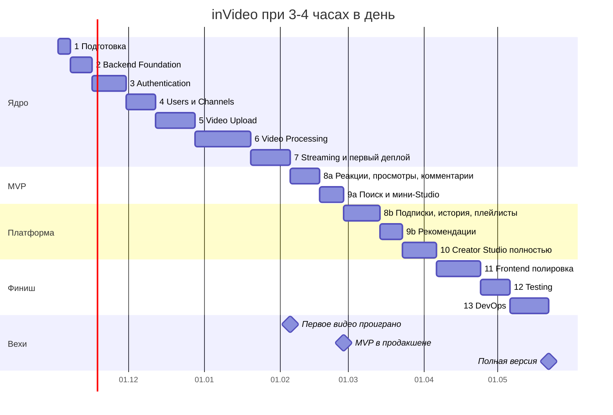

# Часть IX. Roadmap

Полная версия — около 420–620 часов работы. Это **11–16 месяцев** при 1–2 часах в день и **5–7,5 месяца** при 3–4 часах. MVP — около 280–400 часов: **7–10 месяцев** и **3,5–5 месяцев** соответственно. Оценки рассчитаны на разработчика уровня, описанного в задании, и включают время на изучение нового (FFmpeg, HLS, multipart-загрузка), отладку и фронтенд.

## Допущения

- 1–2 часа в день ≈ 9 часов чистой работы в неделю (6 дней, с учётом пропусков).
- 3–4 часа в день ≈ 20 часов в неделю.
- В оценки этапов уже заложено 20–30% на отладку и непредвиденное. Первая встреча с FFmpeg, HLS и S3 multipart почти всегда съедает больше, чем кажется.
- Фронтенд делается параллельно с backend и входит в часы соответствующих этапов; этап 11 — только сборка и полировка.

## Оценка по этапам

| Этап | Часы | Недели при 1–2 ч/день | Недели при 3–4 ч/день | В MVP |
| --- | --- | --- | --- | --- |
| 1. Подготовка проекта | 12–18 | 1,5–2 | 0,5–1 | Да |
| 2. Backend Foundation | 20–30 | 2–3,5 | 1–1,5 | Да |
| 3. Authentication | 30–45 | 3,5–5 | 1,5–2,5 | Да |
| 4. Users и Channels | 25–35 | 3–4 | 1,5–2 | Да |
| 5. Video Upload | 35–50 | 4–5,5 | 2–2,5 | Да |
| 6. Video Processing | 50–75 | 5,5–8,5 | 2,5–4 | Да |
| 7. Video Streaming + первый деплой | 35–50 | 4–5,5 | 2–2,5 | Да |
| 8. Социальные функции | 55–80 | 6–9 | 3–4 | Частично: реакции, просмотры, комментарии (25–35 ч) |
| 9. Поиск и рекомендации | 35–50 | 4–5,5 | 2–2,5 | Частично: поиск (15–20 ч) |
| 10. Creator Studio | 30–45 | 3,5–5 | 1,5–2,5 | Частично: список, статусы, редактирование, удаление (12–18 ч) |
| 11. Frontend: сборка и полировка | 35–55 | 4–6 | 2–3 | Частично (10–15 ч) |
| 12. Testing | 25–40 | 3–4,5 | 1,5–2 | Тесты внутри этапов — да |
| 13. Infrastructure и DevOps | 35–50 | 4–5,5 | 2–2,5 | Частично: бэкап, базовая защита (8–12 ч) |
| **Итого полная версия** | **420–620** | **47–69 (11–16 мес.)** | **21–31 (5–7,5 мес.)** |  |
| **Итого MVP** | **280–400** | **31–45 (7–10 мес.)** | **14–20 (3,5–5 мес.)** |  |

Самые рискованные по срокам этапы — 6 (обработка) и 8 (много функций). Если этап 6 занимает вдвое дольше оценки — это нормально; если втрое — стоит упростить: одно качество меньше, без кандидатов обложки.

## План при 3–4 часах в день

Дата старта условная — сдвиньте под себя. Этапы 8 и 9 разделены на MVP-часть и остальное, чтобы MVP вышел раньше. Базовые задачи этапа 13 (бэкапы, защита сервера) — в любой момент после первого деплоя.

## Вехи

| Веха | Что готово | При 1–2 ч/день | При 3–4 ч/день |
| --- | --- | --- | --- |
| Каркас | Этапы 1–2: окружение, CI, шаблон модуля | 1-й месяц | 2–3-я неделя |
| Авторизация | Этапы 3–4: вход, каналы, подписки | 3-й месяц | 1,5-й месяц |
| **Первое видео проиграно** | Этапы 5–7 и первый деплой | 6–7-й месяц | 3–3,5-й месяц |
| **MVP в продакшене** | Реакции, комментарии, просмотры, поиск, минимальный Studio, бэкап | 7–10-й месяц | 3,5–5-й месяц |
| MVP+ | Подписки, история, плейлисты, тренды | +1–1,5 месяца | +3–4 недели |
| Полная версия | Все этапы | 11–16-й месяц | 5–7,5-й месяц |

## Как не сорвать план

- **Показывайте работу раньше.** Репозиторий с аккуратной историей и README уже на этапе 4–5 — аргумент на собеседовании. Откликаться на вакансии разумно с вехи «Первое видео проиграно», не дожидаясь полной версии.
- **Еженедельный обзор:** что сделано, что заняло больше оценки, нужно ли резать объём. Отставание больше чем на 30% — повод сократить объём до MVP+, а не ускоряться в ущерб тестам.
- **Ограничение по времени на исследования:** если задача не двигается 2–3 сессии подряд — упростить решение и записать это в ADR как осознанный компромисс.
- **Вертикальные срезы:** на этапе 6 сначала сквозной путь с одним качеством, потом всё остальное. Работающее простое лучше недоделанного идеального.
- **Смена деятельности:** когда застряли на сложном (обработка, ротация токенов), переключитесь на задачу «без зависимостей» — бэкапы, дизайн-систему, ADR — и вернитесь со свежей головой.
